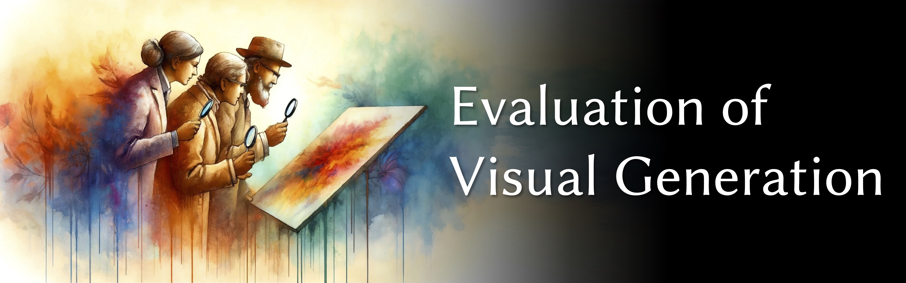

# Awesome Evaluation of Visual Generation

*This repository collects methods for evaluating visual generation.*

## Overview

### What You'll Find Here

Within this repository, we collect works that aim to answer some critical questions in the field of evaluating visual generation, such as:

- **Model Evaluation**: How does one determine the quality of a specific image or video generation model?
- **Sample/Content Evaluation**: What methods can be used to evaluate the quality of a particular generated image or video?
- **User Control Consistency Evaluation**: How to tell how well the generated images and videos align with the user controls or inputs?

### Updates

This repository is updated periodically. If you have suggestions for additional resources, updates on methodologies, or fixes for expiring links, please feel free to do any of the following:
- raise an [Issue](https://github.com/ziqihuangg/Awesome-Evaluation-of-Visual-Generation/issues),
- nominate awesome related works with [Pull Requests](https://github.com/ziqihuangg/Awesome-Evaluation-of-Visual-Generation/pulls),
- We are also contactable via email (`ZIQI002 at e dot ntu dot edu dot sg`).

### Table of Contents
- [1. Evaluation Metrics of Generative Models](#1.)
  - [1.1. Evaluation Metrics of Image Generation](#1.1.)
  - [1.2. Evaluation Metrics of Video Generation](#1.2.)
  - [1.3. Evaluation Metrics for Latent Representation](#1.3.)
- [2. Evaluation Metrics of Condition Consistency](#2.)
  - [2.1 Evaluation Metrics of Multi-Modal Condition Consistency](#2.1.)
  - [2.2. Evaluation Metrics of Image Similarity](#2.2.)
- [3. Evaluation Systems of Generative Models](#3.)
  - [3.1. Evaluation of Unconditional Image Generation](#3.1.)
  - [3.2. Evaluation of Text-to-Image Generation](#3.2.)
  - [3.3. Evaluation of Text-Based Image Editing](#3.3.)
  - [3.4. Evaluation of Neural Style Transfer](#3.4.)
  - [3.5. Evaluation of Video Generation](#3.5.)
  - [3.6. Evaluation of Text-to-Motion Generation](#3.6.)
  - [3.7. Evaluation of Model Trustworthiness](#3.7.)
  - [3.8. Evaluation of Entity Relation](#3.8.)
  - [3.9. Agentic Evaluation](#3.9.)
  - [3.10. Evaluation of Unified Multimodal Models](#3.10.)
- [4. Improving Visual Generation with Evaluation / Feedback / Reward](#4.)
- [5. Quality Assessment for AIGC](#5.)
- [6. Study and Rethinking](#6.)
- [7. Other Useful Resources](#7.)

## 1. Evaluation Metrics of Generative Models

### 1.1. Evaluation Metrics of Image Generation

| Metric | Paper | Code |
| -------- |  -------- |  ------- |
| Inception Score (IS) | [Improved Techniques for Training GANs](https://arxiv.org/abs/1606.03498) (NeurIPS 2016) |  |
| Fréchet Inception Distance (FID) | [GANs Trained by a Two Time-Scale Update Rule Converge to a Local Nash Equilibrium](https://arxiv.org/abs/1706.08500) (NeurIPS 2017) |   |
| Kernel Inception Distance (KID) | [Demystifying MMD GANs](https://arxiv.org/abs/1801.01401) (ICLR 2018) |     
| CLIP-FID | [The Role of ImageNet Classes in Fréchet Inception Distance](https://arxiv.org/abs/2203.06026) (ICLR 2023) |    |
| Precision-and-Recall |[Assessing Generative Models via Precision and Recall](https://arxiv.org/abs/1806.00035) (2018-05-31, NeurIPS 2018)   [Improved Precision and Recall Metric for Assessing Generative Models](https://arxiv.org/abs/1904.06991) (NeurIPS 2019) |        |
| Renyi Kernel Entropy (RKE) | [An Information-Theoretic Evaluation of Generative Models in Learning Multi-modal Distributions](https://openreview.net/forum?id=PdZhf6PiAb) (NeurIPS 2023) |    |
| CLIP Maximum Mean Discrepancy (CMMD) | [Rethinking FID: Towards a Better Evaluation Metric for Image Generation](https://arxiv.org/abs/2401.09603) (CVPR 2024) |  |
| Fréchet Wavelet Distance (FWD) | [Fréchet Wavelet Distance: A Domain-Agnostic Metric For Image Generation](https://openreview.net/pdf?id=QinkNNKZ3b) (ICLR 2025) |  |

+ [Physics-Based Benchmarking Metrics for Multimodal Synthetic Images](https://arxiv.org/abs/2511.15204) (2025-11-19)

+ [Making Reconstruction FID Predictive of Diffusion Generation FID](https://arxiv.org/abs/2603.05630) (2026-03-05)
  
  ><i>Note: Introduces iFID.</i>

+ [Gram-MMD: A Texture-Aware Metric for Image Realism Assessment](https://arxiv.org/abs/2604.03064) (2026-04-03)
  ><i>Note: Introduces Gram-MMD (GMMD).</i>

+ [Relative Classification Accuracy: A Calibrated Metric for Identity Consistency in Fine-Grained K-pop Face Generation](https://arxiv.org/abs/2601.15560) (2026-01-22)
  ><i>Note: Introduces Relative Classification Accuracy (RCA).</i>

+ [Towards a Scalable Reference-Free Evaluation of Generative Models](https://arxiv.org/abs/2407.02961) (2024-07-03)

+ [FaceScore: Benchmarking and Enhancing Face Quality in Human Generation](https://arxiv.org/abs/2406.17100) (2024-06-24)
  ><i>Note: Face Score introduced</i>

+ [Global-Local Image Perceptual Score (GLIPS): Evaluating Photorealistic Quality of AI-Generated Images](https://arxiv.org/abs/2405.09426) (2024-05-15)

+ [Unifying and extending Precision Recall metrics for assessing generative models](https://arxiv.org/abs/2405.01611) (2024-05-02)

+ [Enhancing Plausibility Evaluation for Generated Designs with Denoising Autoencoder](https://arxiv.org/abs/2403.05352) (2024-03-08) 
  ><i>Note: Fréchet Denoised Distance introduced</i>

+ Virtual Classifier Error (VCE) from [Virtual Classifier: A Reversed Approach for Robust Image Evaluation](https://openreview.net/forum?id=IE6FbueT47) (2024-03-04)

+ [An Interpretable Evaluation of Entropy-based Novelty of Generative Models](https://arxiv.org/abs/2402.17287) (2024-02-27)

+ Semantic Shift Rate from [Discovering Universal Semantic Triggers for Text-to-Image Synthesis](https://arxiv.org/abs/2402.07562) (2024-02-12)

+ [Optimizing Prompts Using In-Context Few-Shot Learning for Text-to-Image Generative Models](https://ieeexplore.ieee.org/document/10378642) (2024-01-01)
  ><i>Note: Quality Loss introduced</i>

+ [Attribute Based Interpretable Evaluation Metrics for Generative Models](https://arxiv.org/abs/2310.17261) (2023-10-26) 

+ [On quantifying and improving realism of images generated with diffusion](https://arxiv.org/abs/2309.14756) (2023-09-26)
  ><i>Note: Image Realism Score introduced</i>
 
+ [Probabilistic Precision and Recall Towards Reliable Evaluation of Generative Models](https://arxiv.org/abs/2309.01590) (2023-09-04) 

  ><i>Note: P-precision and P-recall introduced</i>

+ [Learning to Evaluate the Artness of AI-generated Images](https://arxiv.org/abs/2305.04923) (2023-05-08)
  ><i>Note: ArtScore, metric for images resembling authentic artworks by artists</i>

+ [Training-Free Location-Aware Text-to-Image Synthesis](https://arxiv.org/abs/2304.13427) (2023-04-26)  
  > <i>Note: New evaluation metric for control capability of location aware generation task</i>

+ [Feature Likelihood Divergence: Evaluating the Generalization of Generative Models Using Samples](https://arxiv.org/abs/2302.04440) (2023-02-09)

+ [LGSQE: Lightweight Generated Sample Quality Evaluatoin](https://arxiv.org/abs/2211.04590) (2022-11-08)

+ [SSD: Towards Better Text-Image Consistency Metric in Text-to-Image Generation](https://arxiv.org/abs/2210.15235) (2022-10-27)
  > <i>Note: Semantic Similarity Distance introduced</i>

+ [Layout-Bridging Text-to-Image Synthesis](https://arxiv.org/abs/2208.06162) (2022-08-12)
  > <i>Note: Layout Quality Score (LQS), new metric for evaluating the generated layout</i>

+ [Rarity Score: A New Metric to Evaluate the Uncommonness of Synthesized Images](https://arxiv.org/abs/2206.08549) (2022-06-17) 

+ [Mutual Information Divergence: A Unified Metric for Multimodal Generative Models](https://arxiv.org/abs/2205.13445) (2022-05-25)

  ><i>Note: evaluates text to image and utilizes vision language models (VLM)</i>

+ [TREND: Truncated Generalized Normal Density Estimation of Inception Embeddings for GAN Evaluation](https://arxiv.org/abs/2104.14767) (2021-04-30, ECCV 2022)

+ CFID from [Conditional Frechet Inception Distance](https://arxiv.org/abs/2103.11521) (2021-03-21)

+ [On Self-Supervised Image Representations for GAN Evaluation](https://openreview.net/forum?id=NeRdBeTionN) (2021-01-12)

    > <i>Note: SwAV, self-supervised image representation model</i>

+ [Random Network Distillation as a Diversity Metric for Both Image and Text Generation](https://arxiv.org/abs/2010.06715) (2020-10-13)
  ><i>Note: RND metric introduced</i>

+ [The Vendi Score: A Diversity Evaluation Metric for Machine Learning](https://arxiv.org/abs/2210.02410) (2022-10-05) 

+ CIS from [Evaluation Metrics for Conditional Image Generation](https://arxiv.org/abs/2004.12361) (2020-04-26)

+ [Text-To-Image Synthesis Method Evaluation Based On Visual Patterns](https://arxiv.org/abs/1911.00077) (2020-04-09) 

+ [Cscore: A Novel No-Reference Evaluation Metric for Generated Images](https://dl.acm.org/doi/abs/10.1145/3373509.3373546) (2020-03-25)  

+ SceneFID from [Object-Centric Image Generation from Layouts](https://arxiv.org/abs/2003.07449) (2020-03-16)

+ [Reliable Fidelity and Diversity Metrics for Generative Models](https://arxiv.org/abs/2002.09797) (2020-02-23, ICML 2020)  
 

+ [Effectively Unbiased FID and Inception Score and where to find them](https://arxiv.org/abs/1911.07023) (2019-11-16, CVPR 2020)  

+ [On the Evaluation of Conditional GANs](https://arxiv.org/abs/1907.08175) (2019-07-11)
  ><i>Note:Fréchet Joint Distance (FJD), which is able to assess image quality, conditional consistency, and intra-conditioning diversity within a single metric.</i>

+ [Quality Evaluation of GANs Using Cross Local Intrinsic Dimensionality](https://arxiv.org/abs/1905.00643) (2019-05-02)
  > <i>CrossLID, assesses the local intrinsic dimensionality </i>

+ [A domain agnostic measure for monitoring and evaluating GANs](https://arxiv.org/abs/1811.05512) (2018-11-13) 

+ [Learning to Generate Images with Perceptual Similarity Metrics](https://arxiv.org/abs/1511.06409) (2015-11-19)
  > <i>Multiscale structural-similarity score introduced</i>

+ [A No-Reference Image Blur Metric Based on the Cumulative Probability of Blur Detection (CPBD)](https://ieeexplore.ieee.org/document/5739529) (2011-03-28) 

### 1.2. Evaluation Metrics of Video Generation

| Metric | Paper | Code |
| -------- |  -------- |  ------- |
| FID-vid | [GANs Trained by a Two Time-Scale Update Rule Converge to a Local Nash Equilibrium](https://arxiv.org/abs/1706.08500) (NeurIPS 2017) |  |
| Fréchet Video Distance (FVD) | [Towards Accurate Generative Models of Video: A New Metric & Challenges](https://arxiv.org/abs/1812.01717) (arXiv 2018)   [FVD: A new Metric for Video Generation](https://openreview.net/forum?id=rylgEULtdN) (2019-05-04)  <i> (Note: ICLR 2019 Workshop DeepGenStruct Program Chairs)</i>|  |

### 1.3. Evaluation Metrics for Latent Representation

+ Linear Separability & Perceptual Path Length (PPL) from [A Style-Based Generator Architecture for Generative Adversarial Networks](https://arxiv.org/abs/1812.04948) (2020-01-09)

## 2. Evaluation Metrics of Condition Consistency

### 2.1 Evaluation Metrics of Multi-Modal Condition Consistency

| Metric | Condition | Pipeline | Code | References | 
| -------- |  -------- |  ------- | -------- |  -------- |  
| CLIP Score (`a.k.a.` CLIPSIM) | Text | cosine similarity between the CLIP image and text embeddings |   [PyTorch Lightning](https://lightning.ai/docs/torchmetrics/stable/multimodal/clip_score.html) | [CLIP Paper](https://arxiv.org/abs/2103.00020) (ICML 2021). Metrics first used in [CLIPScore Paper](https://arxiv.org/abs/2104.08718) (arXiv 2021) and [GODIVA Paper](https://arxiv.org/abs/2104.14806) (arXiv 2021) applies it in video evaluation. |
| Mask Accuracy | Segmentation Mask | predict the segmentatio mask, and compute pixel-wise accuracy against the ground-truth segmentation mask | any segmentation method for your setting |
| DINO Similarity | Image of a Subject (human / object *etc*) | cosine similarity between the DINO embeddings of the generated image and the condition image |  | [DINO paper](https://arxiv.org/abs/2104.14294). Metric is proposed in [DreamBooth](https://arxiv.org/abs/2208.12242).

<!-- | Identity Consistency | Image of a Face |  | - | -->

<!-- 
Papers for CLIP Similarity:
[Learning Transferable Visual Models From Natural Language Supervision](https://arxiv.org/abs/2103.00020) (ICML 2021), [CLIPScore: A Reference-free Evaluation Metric for Image Captioning](https://arxiv.org/abs/2104.08718) (arXiv 2021), [GODIVA: Generating Open-DomaIn Videos from nAtural Descriptions](https://arxiv.org/abs/2104.14806) (arXiv 2021) |  [PyTorch Lightning](https://lightning.ai/docs/torchmetrics/stable/multimodal/clip_score.html) -->

+ NexusScore, NaturalScore and GmeScore from [OpenS2V-Nexus: A Detailed Benchmark and Million-Scale Dataset for Subject-to-Video Generation](https://arxiv.org/abs/2505.20292) (2025-06-03)
  ><i>Note: NexusScore - Identity Consistency - image retrieval + cosine similarity; NaturalScore - Identity Naturalness - prompting gpt4o; GmeScore - Text - cosine similarity between the GME image and text embeddings.</i>

+ FaceSim-Cur from [Identity-Preserving Text-to-Video Generation by Frequency Decomposition](https://arxiv.org/abs/2411.17440) (2024-11-26)
  ><i>Note: NFaceSim-Cur - Face image of human - cosine similarity between the curricularface embeddings of the generated face and the input face.</i>

+ Manipulation Direction (MD) from [Manipulation Direction: Evaluating Text-Guided Image Manipulation Based on Similarity between Changes in Image and Text Modalities](https://www.ncbi.nlm.nih.gov/pmc/articles/PMC10675000/) (2023-11-20)

+ [Semantic Similarity Distance: Towards better text-image consistency metric in text-to-image generation](https://www-sciencedirect-com.remotexs.ntu.edu.sg/science/article/pii/S0031320323005812?via%3Dihub) (2022-12-02)

+ [On the Evaluation of Conditional GANs](https://arxiv.org/abs/1907.08175) (2019-07-11)
  ><i>Note: Fréchet Joint Distance (FJD), which is able to assess image quality, conditional consistency, and intra-conditioning diversity within a single metric.</i>

+ [Classification Accuracy Score for Conditional Generative Models](https://arxiv.org/abs/1905.10887) (2019-05-26)
    > <i>Note: New metric Classification Accuracy Score (CAS)</i>

+ Visual-Semantic (VS) Similarity from [Photographic Text-to-Image Synthesis with a Hierarchically-nested Adversarial Network](https://arxiv.org/abs/1802.09178v2) (2018-12-26)

+ [Semantically Invariant Text-to-Image Generation](https://arxiv.org/abs/1809.10274) (2018-09-06)

    > <i>Note: They evaluate image-text similarity via image captioning</i>

+ [Inferring Semantic Layout for Hierarchical Text-to-Image Synthesis](https://arxiv.org/abs/1801.05091v2) (2018-01-16) 
    > <i>Note: An object detector based metric is proposed.</i>

### 2.2. Evaluation Metrics of Image Similarity

+ [CLPIPS: A Personalized Metric for AI-Generated Image Similarity](https://arxiv.org/abs/2604.01234) (2026-03-26)

+ [MEt3R: Measuring Multi-View Consistency in Generated Images](https://arxiv.org/abs/2501.06336) (2025-01-10)
  

+ [Pathology-Guided Virtual Staining Metric for Evaluation and Training](https://arxiv.org/abs/2507.12624) (2025-07-16)
  ><i>Note: Introduces the Pathology-Aware Perceptual Image Similarity (PaPIS) metric.</i>

| Metrics | Paper | Code |
| -------- |  -------- |  ------- |
| Learned Perceptual Image Patch Similarity (LPIPS) | [The Unreasonable Effectiveness of Deep Features as a Perceptual Metric](https://arxiv.org/abs/1801.03924) (2018-01-11) (CVPR 2018) |   |
| Structural Similarity Index (SSIM) | [Image quality assessment: from error visibility to structural similarity](https://ieeexplore.ieee.org/document/1284395) (TIP 2004) |     |
| Peak Signal-to-Noise Ratio (PSNR) | - |    |
| Multi-Scale Structural Similarity Index (MS-SSIM) | [Multiscale structural similarity for image quality assessment](https://ieeexplore.ieee.org/document/1292216) (SSC 2004) | [PyTorch-Metrics](https://lightning.ai/docs/torchmetrics/stable/image/multi_scale_structural_similarity.html#:~:text=Compute%20MultiScaleSSIM%2C%20Multi%2Dscale%20Structural,details%20at%20different%20resolution%20scores.&text=a%20method%20to%20reduce%20metric%20score%20over%20labels.) |
| Feature Similarity Index (FSIM) | [FSIM: A Feature Similarity Index for Image Quality Assessment](https://ieeexplore.ieee.org/document/5705575) (TIP 2011) | 

The community has also been using [DINO](https://arxiv.org/abs/2104.14294) or [CLIP](https://arxiv.org/abs/2103.00020) features to measure the semantic similarity of two images / frames.

There are also recent works on new methods to measure visual similarity (more will be added):

+ [DreamSim: Learning New Dimensions of Human Visual Similarity using Synthetic Data](https://arxiv.org/abs/2306.09344) (2023-06-15)  
  
  
  

## 3. Evaluation Systems of Generative Models

### 3.1. Evaluation of Unconditional Image Generation

+ [Synthetic Melanoma Image Generation and Evaluation Using Generative Adversarial Networks](https://arxiv.org/abs/2603.13497) (2026-03-13)

+ [AesBench: An Expert Benchmark for Multimodal Large Language Models on Image Aesthetics Perception](https://arxiv.org/abs/2401.08276) (2024-01-16) 

+ [A Lightweight Generalizable Evaluation and Enhancement Framework for Generative Models and Generated Samples](https://ieeexplore.ieee.org/document/10495634) (2024-04-16) 

+ [Anomaly Score: Evaluating Generative Models and Individual Generated Images based on Complexity and Vulnerability](https://arxiv.org/abs/2312.10634) (2023-12-17, CVPR 2024) 

+ [Using Skew to Assess the Quality of GAN-generated Image Features](https://arxiv.org/abs/2310.20636) (2023-10-31) 
 > <i>Note: Skew Inception Distance introduced</i>

+ [StudioGAN: A Taxonomy and Benchmark of GANs for Image Synthesis](https://arxiv.org/abs/2206.09479) (2022-06-19)
 

+ [HYPE: A Benchmark for Human eYe Perceptual Evaluation of Generative Models](https://arxiv.org/abs/1904.01121) (2019-04-01)  

+ [An Improved Evaluation Framework for Generative Adversarial Networks](https://arxiv.org/abs/1803.07474) (2018-03-20) 
 > <i>Note: Class-Aware Frechet Distance introduced</i>

### 3.2. Evaluation of Text-to-Image Generation

+ [Simile Understanding in Text-to-Image Models: An Evaluation Framework](https://arxiv.org/abs/2608.04750) (2026-08-05)

+ [Can Text-to-Image Models Draw from the Right Frame of Reference?](https://arxiv.org/abs/2608.03357) (2026-08-04)
  

+ [ExpertVerse: A General-Purpose Benchmark for Expert-Level Reasoning in Knowledge-Intensive Visual Synthesis](https://arxiv.org/abs/2607.19341) (2026-07-21)
  

+ [DynEval: Holistic Evaluations of T2I Generative Models in the Wild](https://arxiv.org/abs/2607.11199) (2026-07-13)
  

+ [TIIF-Bench: How Does Your T2I Model Follow Your Instructions?](https://arxiv.org/abs/2506.02161) (2025-06-02)
  
  
  

+ [PIPBench: A Profile-Inclusive Framework for Personalized Image Generation Evaluation](https://arxiv.org/abs/2607.06440) (2026-07-07)
  
  
  
  
  

+ [KathaTrace: Diagnosing Semantic Trajectory Collapse in Generated Visual Narratives](https://arxiv.org/abs/2607.01312) (2026-07-01)

+ [Are Text-to-Image Models Inductivist Turkeys? A Counterfactual Benchmark for Causal Reasoning](https://arxiv.org/abs/2606.24548) (2026-06-23)
  
  

+ [DSH-Bench: A Difficulty- and Scenario-Aware Benchmark with Hierarchical Subject Taxonomy for Subject-Driven Text-to-Image Generation](https://arxiv.org/abs/2603.08090) (2026-03-09)

+ [Scaling Multi-Reference Image Generation with Dynamic Reward Optimization](https://arxiv.org/abs/2606.26947) (2026-06-25)
  

+ [Qwen-Image-Bench: From Generation to Creation in Text-to-Image Evaluation](https://arxiv.org/abs/2605.28091) (2026-05-27)
  
  
  
  
  
  
  
  
  

+ [Can AI Draw Science? A Benchmark for Evaluating Scientific Figure Generation by Text-to-Image and Multimodal Models](https://arxiv.org/abs/2606.28406) (2026-06-24)

+ [GeoFidelity-Bench: Evaluating Segment-Level Geographic Fidelity in Text-to-Image Street-View Generation](https://arxiv.org/abs/2606.23669) (2026-06-22)
  

+ [WeGenBench: A Multidimensional Diagnostic Benchmark towards Text-to-Image Model Optimization](https://arxiv.org/abs/2606.20100) (2026-06-18)
  

+ [GarmentSketch: Large-scale Sketch-to-Fashion Benchmark](https://arxiv.org/abs/2606.14025) (2026-06-12)
  

+ [The 1st PortraitCraft Challenge: A CVPR 2026 Workshop Competition on Portrait Composition Understanding and Generation](https://arxiv.org/abs/2606.10894) (2026-06-09)

+ [Faithful, Enriched, and Precise: Benchmarking Natural-Science Illustration Generation by T2I models](https://arxiv.org/abs/2606.05949) (2026-06-04)

+ [TASTE: A Designer-Annotated Multi-Dimensional Preference Dataset for AI-Generated Graphic Design](https://arxiv.org/abs/2605.20731) (2026-05-20)
  

+ [TextAlign: Preference Alignment for Text Rendering with Hierarchical Rewards](https://arxiv.org/abs/2605.19320) (2026-05-19)

+ [DetailMaster: Can Your Text-to-Image Model Handle Long Prompts?](https://arxiv.org/abs/2505.16915) (2025-05-22)
  

+ [Benchmarking and Enhancing Text-to-Image Models for Generating Visual Representations in Early Arithmetic Education](https://arxiv.org/abs/2605.31212) (2026-05-29)

+ [DyCoRM: Dynamic Criterion-Aware Reward Modeling for Text-to-Image Generation](https://arxiv.org/abs/2605.25876) (2026-05-25)

+ [MaSC: A Masked Similarity Metric for Evaluating Concept-Driven Generation](https://arxiv.org/abs/2605.22469) (2026-05-21)
  

+ [A Framework for Evaluating Zero-Shot Image Generation in Concept-based Explainability](https://arxiv.org/abs/2605.19855) (2026-05-19)
  

+ [Benchmarking and Evolving Reason-Reflect-Rectify for Reflective Visual Generation](https://arxiv.org/abs/2605.19639) (2026-05-19)
  

+ [ColorConceptBench: A Benchmark for Probabilistic Color-Concept Understanding in Text-to-Image Models](https://arxiv.org/abs/2601.16836) (2026-01-23)

+ [TIQA: Human-Aligned Perceptual Text Quality Assessment in Generated Images](https://arxiv.org/abs/2603.07119) (2026-03-07)

+ [Benchmarking Layout-Guided Diffusion Models through Unified Semantic-Spatial Evaluation in Closed and Open Settings](https://arxiv.org/abs/2604.25358) (2026-04-28)
  

+ [Knowledge Visualization: A Benchmark and Method for Knowledge-Intensive Text-to-Image Generation](https://arxiv.org/abs/2604.22302) (2026-04-24)
  

+ [Pref-GRPO: Pairwise Preference Reward-based GRPO for Stable Text-to-Image Reinforcement Learning](https://arxiv.org/abs/2508.20751) (2025-08-28)
  

+ [GENFIG1: Visual Summaries of Scholarly Work as a Challenge for Vision-Language Models](https://arxiv.org/abs/2604.04172) (2026-04-05)

+ [ViStoryBench: Comprehensive Benchmark Suite for Story Visualization](https://arxiv.org/abs/2505.24862) (2025-05-30)
  
  
  

+ [When Identities Collapse: A Stress-Test Benchmark for Multi-Subject Personalization](https://arxiv.org/abs/2603.26078) (2026-03-27)

+ [BizGenEval: A Systematic Benchmark for Commercial Visual Content Generation](https://arxiv.org/abs/2603.25732) (2026-03-26)
  

+ [Diffusion Probe: Generated Image Result Prediction Using CNN Probes](https://arxiv.org/abs/2602.23783) (2026-02-27)
  

+ [TechImage-Bench: Rubric-Based Evaluation for Technical Image Generation](https://arxiv.org/abs/2512.12220) (2025-12-13)

+ [MIBE: Multi-subject Interaction Benchmark and Evaluator for Personalized Image Generation](https://arxiv.org/abs/2607.01383) (2026-07-01)

+ [CogCanvas: A Benchmark for Evaluating Multi-Subject Reference-Based Image Generation](https://arxiv.org/abs/2606.15867) (2026-06-14)
  
  
  

+ [GlazyBench: A Benchmark for Ceramic Glaze Property Prediction and Image Generation](https://arxiv.org/abs/2605.06641) (2026-05-07)

+ [PortraitCraft: A Benchmark for Portrait Composition Understanding and Generation](https://arxiv.org/abs/2604.03611) (2026-04-04)

+ [AIBench: Evaluating Visual-Logical Consistency in Academic Illustration Generation](https://arxiv.org/abs/2603.28068) (2026-03-30)

+ [MultiBind: A Benchmark for Attribute Misbinding in Multi-Subject Generation](https://arxiv.org/abs/2603.21937) (2026-03-23)

+ [Counting Hallucinations in Diffusion Models](https://arxiv.org/abs/2510.13080) (2025-10-15)

+ [Beyond the Pixels: VLM-based Evaluation of Identity Preservation in Reference-Guided Synthesis](https://arxiv.org/abs/2511.08087) (2025-11-11)

+ [SinSEMI: A One-Shot Image Generation Model and Data-Efficient Evaluation Framework for Semiconductor Inspection Equipment](https://arxiv.org/abs/2511.06740) (2025-11-10)

+ [Mind-the-Glitch: Visual Correspondence for Detecting Inconsistencies in Subject-Driven Generation](https://arxiv.org/abs/2509.21989) (2025-09-26)
  

+ [Visual Personalization Turing Test](https://arxiv.org/abs/2601.22680) (2026-01-30, CVPR 2026)
  

+ [Finer-Personalization Rank: Fine-Grained Retrieval Examines Identity Preservation for Personalized Generation](https://arxiv.org/abs/2512.19026) (2025-12-22)

+ [Human Preference-Aligned Concept Customization Benchmark via Decomposed Evaluation](https://arxiv.org/abs/2509.03385) (2025-09-03)
  
+ [GenColorBench: A Color Evaluation Benchmark for Text-to-Image Generation Models](https://arxiv.org/pdf/2510.20586) (2025-10)

+ [SCIEval: Evaluating and Benchmarking the Faithfulness of Scientific Image Generation and Interpretation with Large Multimodal Models](https://openaccess.thecvf.com/content/CVPR2026/papers/Ye_SCIEval_Evaluating_and_Benchmarking_the_Faithfulness_of_Scientific_Image_Generation_CVPR_2026_paper.pdf) (CVPR 2026)

+ [ServImage: An Image Generation and Editing Benchmark from Real-World Commercial Imaging Services](https://arxiv.org/pdf/2604.24023) (2026-04)
  
  ><i>Note: Introduces ServImageScore.</i>

+ [LongT2IBench: A Benchmark for Evaluating Long Text-to-Image Generation with Graph-Structured Annotations](https://arxiv.org/pdf/2512.09271) (2025-12)
  
  
  

+ [OverLayBench: A Benchmark for Layout-to-Image Generation with Dense Overlaps](https://arxiv.org/pdf/2509.19282) (2025-09-23)
  
  ><i>Note: Introduces OverLayScore.</i>

+ [ICE-Bench: A Unified and Comprehensive Benchmark for Image Creating and Editing](https://arxiv.org/pdf/2503.14482) (2025-03)
  
  
  
  ><i>Note: Introduces VLLM-QA.</i>

+ [MultiHuman-Testbench: Benchmarking Image Generation for Multiple Humans](https://arxiv.org/pdf/2506.20879) (2025-06)
  

+ [MMMG: A Massive, Multidisciplinary, Multi-Tier Generation Benchmark for Text-to-Image Reasoning](https://arxiv.org/pdf/2506.10963) (2025-06)
  
  
  ><i>Note: Introduces MMMG-Score.</i>

+ [MMIG-Bench: Towards Comprehensive and Explainable Evaluation of Multi-Modal Image Generation Models](https://arxiv.org/pdf/2505.19415) (2025-05)
  
  
  ><i>Note: Introduces the Aspect Matching Score (AMS).</i>

+ [SciFlow-Bench: Evaluating Structure-Aware Scientific Diagram Generation via Inverse Parsing](https://arxiv.org/abs/2602.09809) (2026-02-10)
  

+ [IGenBench: Benchmarking the Reliability of Text-to-Infographic Generation](https://arxiv.org/abs/2601.04498) (2026-01-08)
  
  
  

+ [Automatic and Reliable Evaluation for Academic Caption-to-Figure Generation with LMMs](https://aclanthology.org/2026.acl-long.2055.pdf) (ACL 2026)

+ Scendi Score from [Scendi Score: Prompt-Aware Diversity Evaluation via Schur Complement of CLIP Embeddings](https://openaccess.thecvf.com/content/ICCV2025/papers/Ospanov_Scendi_Score_Prompt-Aware_Diversity_Evaluation_via_Schur_Complement_of_CLIP_ICCV_2025_paper.pdf) (ICCV 2025)
  
  ><i>Note: Introduces the Scendi Score for prompt-aware diversity evaluation.</i>

+ [P2P: Automated Paper-to-Poster Generation and Fine-Grained Benchmark](https://proceedings.iclr.cc/paper_files/paper/2026/file/1fe6f635fe265292aba3987b5123ae3d-Paper-Conference.pdf) (ICLR 2026)
  
  

+ [Too Vivid to Be Real? Benchmarking and Calibrating Generative Color Fidelity](https://arxiv.org/abs/2603.10990) (CVPR 2026)
  
  
  
  ><i>Note: Introduces the Color Fidelity Metric (CFM).</i>

+ [PosterIQ: A Design Perspective Benchmark for Poster Understanding and Generation](https://arxiv.org/pdf/2603.24078) (2026-03-25)
  

+ [MultiBanana: A Challenging Benchmark for Multi-Reference Text-to-Image Generation](https://arxiv.org/abs/2511.22989) (2025-11-28)
  
  
+ [GenExam: A Multidisciplinary Text-to-Image Exam](https://arxiv.org/abs/2509.14232) (2025-09-17)
  

+ [What Makes a Scene ? Scene Graph-based Evaluation and Feedback for Controllable Generation](https://arxiv.org/abs/2411.15435) (2024-05-26)

+ [Commonsense-T2I Challenge: Can Text-to-Image Generation Models Understand Commonsense?](https://arxiv.org/abs/2406.07546) (2024-08-12)
 

+ [WISE: A World Knowledge-Informed Semantic Evaluation for Text-to-Image Generation](https://arxiv.org/abs/2503.07265) (2025-03-10)
  
  
  

+ [Why Settle for One? Text-to-ImageSet Generation and Evaluation](https://arxiv.org/abs/2506.23275) (2025-06-29)
  
  
  

+ [LMM4LMM: Benchmarking and Evaluating Large-multimodal Image Generation with LMMs](https://arxiv.org/abs/2504.08358) (2025-04-11)
  

+ [Robust and Discriminative Speaker Embedding via  Intra-Class Distance Variance Regularization](https://www.isca-archive.org/interspeech_2018/le18_interspeech.html) (2018-09)
  ><i>Note: IntraClass Average Distance(ICAD) - Diversity </i>

+ [REAL: Realism Evaluation of Text-to-Image Generation Models for Effective Data Augmentation](https://arxiv.org/abs/2502.10663). (2025-02-15)

+ [ABHINAW: A method for Automatic Evaluation of Typography within AI-Generated Images](https://arxiv.org/abs/2409.11874) (2024-09-18)

+ [Finding the Subjective Truth: Collecting 2 Million Votes for Comprehensive Gen-AI Model Evaluation](https://arxiv.org/abs/2409.11904) (2024-09-18)

+ [Beyond Aesthetics: Cultural Competence in Text-to-Image Models](https://arxiv.org/abs/2407.06863) (2024-07-09)
  > <i>Note: CUBE benchmark introduced</i>

+ [MJ-Bench: Is Your Multimodal Reward Model Really a Good Judge for Text-to-Image Generation?](https://arxiv.org/abs/2407.04842) (2024-07-05) 
  > <i>Note: MJ-Bench introduced</i>

+ [MIGC++: Advanced Multi-Instance Generation Controller for Image Synthesis](https://arxiv.org/abs/2407.02329) (2024-07-02) 

  > <i>Note: Benchmark COCO-MIG and Multimodal-MIG introduced</i>

+ [Analyzing Quality, Bias, and Performance in Text-to-Image Generative Models](https://arxiv.org/abs/2407.00138) (2024-06-28)

+ [EvalAlign: Evaluating Text-to-Image Models through Precision Alignment of Multimodal Large Models with Supervised Fine-Tuning to Human Annotations](https://arxiv.org/abs/2406.16562) (2024-06-24)

+ [DreamBench++: A Human-Aligned Benchmark for Personalized Image Generation](https://arxiv.org/abs/2406.16855) (2024-06-24)

+ [Six-CD: Benchmarking Concept Removals for Benign Text-to-image Diffusion Models](https://arxiv.org/pdf/2406.14855) (2024-06-21) 

+ [Evaluating Numerical Reasoning in Text-to-Image Models](https://arxiv.org/abs/2406.14774) (2024-06-20) 
    > <i>Note: GeckoNum introduced</i>

+ [Holistic Evaluation for Interleaved Text-and-Image Generation](https://arxiv.org/abs/2406.14643) (2024-06-20) 
    > <i>Note: InterleavedBench and InterleavedEval metric introduced</i>

+ [GenAI-Bench: Evaluating and Improving Compositional Text-to-Visual Generation](https://arxiv.org/abs/2406.13743) (2024-06-19)

+ [Decomposed evaluations of geographic disparities in text-to-image models](https://arxiv.org/abs/2406.11988) (2024-06-17)

    > <i>Note: new metric Decomposed Indicators of Disparities introduced</i>

+ [PhyBench: A Physical Commonsense Benchmark for Evaluating Text-to-Image Models](https://arxiv.org/abs/2406.11802) (2024-06-17) 

    > <i>Note: PhyBench introduced</i>

+ [Make It Count: Text-to-Image Generation with an Accurate Number of Objects](https://arxiv.org/abs/2406.10210) (2024-06-14)

+ [Commonsense-T2I Challenge: Can Text-to-Image Generation Models Understand Commonsense?](https://arxiv.org/abs/2406.07546) (2024-06-11)

    > <i>Note:  Commonsense-T2I, benchmark for real-life commonsense reasoning capabilities of T2I models</i>

+ [Unified Text-to-Image Generation and Retrieval](https://arxiv.org/abs/2406.05814) (2024-06-09)
    > <i>Note: TIGeR-Bench, benchmark for evaluation of unified text-to-image generation and retrieval.</i>

+ [PQPP: A Joint Benchmark for Text-to-Image Prompt and Query Performance Prediction](https://arxiv.org/abs/2406.04746) (2024-06-07)

+ [GenAI Arena: An Open Evaluation Platform for Generative Models](https://arxiv.org/abs/2406.04485) (2024-06-06) 

+ [A-Bench: Are LMMs Masters at Evaluating AI-generated Images?](https://arxiv.org/abs/2406.03070) (2024-06-05)  
      

+ Multidimensional Preference Score from [Learning Multi-dimensional Human Preference for Text-to-Image Generation](https://arxiv.org/abs/2405.14705) (2024-05-23)

+ [Evolving Storytelling: Benchmarks and Methods for New Character Customization with Diffusion Models](https://arxiv.org/abs/2405.11852) (2024-05-20) 
  ><i>Note: NewEpisode benchmark introduced</i>

+ [Training-free Subject-Enhanced Attention Guidance for Compositional Text-to-image Generation](https://arxiv.org/abs/2405.06948) (2024-05-11) 
  ><i>Note: GroundingScore metric introduced</i>

+ [TheaterGen: Character Management with LLM for Consistent Multi-turn Image Generation](https://arxiv.org/abs/2404.18919) (2024-04-29)

  ><i>Note: consistent score r introduced</i>

+ [Exposing Text-Image Inconsistency Using Diffusion Models](https://arxiv.org/abs/2404.18033) (2024-04-28) 

+ [Revisiting Text-to-Image Evaluation with Gecko: On Metrics, Prompts, and Human Ratings](https://arxiv.org/abs/2404.16820) (2024-04-25)  

+ [Multimodal Large Language Model is a Human-Aligned Annotator for Text-to-Image Generation](https://arxiv.org/abs/2404.15100) (2024-04-23)  

+ [Infusion: Preventing Customized Text-to-Image Diffusion from Overfitting](https://arxiv.org/abs/2404.14007) (2024-04-22)
  ><i>Note: Latent Fisher divergence and Wasserstein metric introduced</i>

+ [TAVGBench: Benchmarking Text to Audible-Video Generation](https://arxiv.org/abs/2404.14381) (2024-04-22)  
  

+ [Object-Attribute Binding in Text-to-Image Generation: Evaluation and Control](https://arxiv.org/abs/2404.13766) (2024-04-21)  

+ [Magic Clothing: Controllable Garment-Driven Image Synthesis](https://arxiv.org/abs/2404.09512) (2024-04-15) 

  > <i>Note: new metric Matched-Points-LPIPS introduced</i>

+ [GenAI-Bench: A Holistic Benchmark for Compositional Text-to-Visual Generation](https://openreview.net/forum?id=hJm7qnW3ym) (2024-04-09)
  > <i>Note: GenAI-Bench was introduced in a previous paper 'Evaluating Text-to-Visual Generation with Image-to-Text Generation'</i>

+ Detect-and-Compare from [Identity Decoupling for Multi-Subject Personalization of Text-to-Image Models](https://arxiv.org/abs/2404.04243) (2024-04-05) 

+ [Enhancing Text-to-Image Model Evaluation: SVCS and UCICM](https://ieeexplore.ieee.org/abstract/document/10480770) (2024-04-02)
    > <i>Note: Evaluation metrics: Semantic Visual Consistency Score and User-Centric Image Coherence Metric </i>

+ [Evaluating Text-to-Visual Generation with Image-to-Text Generation](https://arxiv.org/abs/2404.01291) (2024-04-01)  
  
  

+ [Measuring Style Similarity in Diffusion Models](https://arxiv.org/abs/2404.01292) (2024-04-01)  
  

+ [AAPMT: AGI Assessment Through Prompt and Metric Transformer](https://arxiv.org/abs/2403.19101) (2024-03-28)

+ [FlashEval: Towards Fast and Accurate Evaluation of Text-to-image Diffusion Generative Models](https://arxiv.org/abs/2403.16379) (2024-03-25)

+ [Refining Text-to-Image Generation: Towards Accurate Training-Free Glyph-Enhanced Image Generation](https://arxiv.org/abs/2403.16422) (2024-03-25) 
  > <i>Note: LenCom-Eval introduced</i>

+ [Exploring GPT-4 Vision for Text-to-Image Synthesis Evaluation](https://openreview.net/forum?id=xmQoodG82a) (2024-03-20)

+ [DialogGen: Multi-modal Interactive Dialogue System for Multi-turn Text-to-Image Generation](https://arxiv.org/abs/2403.08857) (2024-03-13) 

  > <i>Note: DialogBen introduced</i>

+ [Evaluating Text-to-Image Generative Models: An Empirical Study on Human Image Synthesis](https://arxiv.org/abs/2403.05125) (2024-03-08) 

+ [An Information-Theoretic Evaluation of Generative Models in Learning Multi-modal Distributions](https://openreview.net/forum?id=PdZhf6PiAb) (2024-02-13)  
  

+ [MIGC: Multi-Instance Generation Controller for Text-to-Image Synthesis](https://arxiv.org/abs/2402.05408) (2024-02-08) 

  > <i>Note: COCO-MIG benchmark introduced</i>

+ [CAS: A Probability-Based Approach for Universal Condition Alignment Score](https://openreview.net/forum?id=E78OaH2s3f) (2024-01-16)  
    
    > <i>Note: Condition alignment of text-to-image, {instruction, image}-to-image, edge-/scribble-to-image, and text-to-audio</i>

+ [EmoGen: Emotional Image Content Generation with Text-to-Image Diffusion Models](https://arxiv.org/abs/2401.04608) (2024-01-09) 

  ><i>Note: emotion accuracy, semantic clarity and semantic diversity are not core contributions of this paper</i>

+ [VIEScore: Towards Explainable Metrics for Conditional Image Synthesis Evaluation](https://arxiv.org/abs/2312.14867) (2023-12-22)  
    

+ [PIA: Your Personalized Image Animator via Plug-and-Play Modules in Text-to-Image Models](https://arxiv.org/abs/2312.13964) (2023-12-21)
 
    > <i>Note: AnimateBench, benchmark for comparisons in the field of personalized image animation</i>

+ [Stellar: Systematic Evaluation of Human-Centric Personalized Text-to-Image Methods](https://arxiv.org/abs/2312.06116) (2023-12-11)  
  
  

+ [A Contrastive Compositional Benchmark for Text-to-Image Synthesis: A Study with Unified Text-to-Image Fidelity Metrics](https://arxiv.org/abs/2312.02338) (2023-12-04)  
  

+ [The Challenges of Image Generation Models in Generating Multi-Component Images](https://arxiv.org/abs/2311.13620) (2023-11-22) 

+ [SelfEval: Leveraging the discriminative nature of generative models for evaluation](https://arxiv.org/abs/2311.10708) (2023-11-17)

+ [GPT-4V(ision) as a Generalist Evaluator for Vision-Language Tasks](https://arxiv.org/abs/2311.01361) (2023-11-02)

+ [Davidsonian Scene Graph: Improving Reliability in Fine-grained Evaluation for Text-to-Image Generation](https://arxiv.org/abs/2310.18235) (2023-10-27, ICLR 2024)  
  
  

+ [DEsignBench: Exploring and Benchmarking DALL-E 3 for Imagining Visual Design](https://arxiv.org/abs/2310.15144) (2023-10-23)  
  
  

+ [GenEval: An Object-Focused Framework for Evaluating Text-to-Image Alignment](https://arxiv.org/abs/2310.11513) (2023-10-17)  
    

+ [Hypernymy Understanding Evaluation of Text-to-Image Models via WordNet Hierarchy](https://arxiv.org/abs/2310.09247) (2023-10-13)  
    

+ [SingleInsert: Inserting New Concepts from a Single Image into Text-to-Image Models for Flexible Editing](https://arxiv.org/abs/2310.08094) (2023-10-12)  
    
  > <i> Note: New Metric: Editing Success Rate </i>

+ [ImagenHub: Standardizing the evaluation of conditional image generation models](https://arxiv.org/abs/2310.01596) (2023-10-02)  
    
  

+ [Navigating Text-To-Image Customization: From LyCORIS Fine-Tuning to Model Evaluation](https://arxiv.org/abs/2309.14859) (2023-09-26, ICLR 2024)  
  

+ Concept Score from [Text-to-Image Generation for Abstract Concepts](https://paperswithcode.com/paper/text-to-image-generation-for-abstract) (2023-09-26) 

+ [OpenLEAF: Open-Domain Interleaved Image-Text Generation and Evaluation](https://openreview.net/forum?id=SeiL55hCnu) (2023-09-23) 
   [GenAI-Arena](https://huggingface.co/papers/2310.07749)
  > <i>Note: Evaluates task of image and text generation</i>
  
+ [Progressive Text-to-Image Diffusion with Soft Latent Direction](https://arxiv.org/abs/2309.09466) (2023-09-18)

    ><i>Note: Benchmark for text-to-image generation tasks</i>

+ [AltDiffusion: A Multilingual Text-to-Image Diffusion Model](https://arxiv.org/abs/2308.09991) (2023-08-19, AAAI 2024)

    ><i>Note: Benchmark with focus on multilingual generation aspect</i>

<!-- + [JourneyDB: A Benchmark for Generative Image Understanding](https://arxiv.org/abs/2307.00716) (2023-07-03, NeurIPS 2023)  
  
   -->

+ LEICA from [Likelihood-Based Text-to-Image Evaluation with Patch-Level Perceptual and Semantic Credit Assignment](https://arxiv.org/abs/2308.08525) (2023-08-16)
  
+ [Let's ViCE! Mimicking Human Cognitive Behavior in Image Generation Evaluation](https://arxiv.org/abs/2307.09416) (2023-07-18)  

+ [T2I-CompBench: A Comprehensive Benchmark for Open-world Compositional Text-to-image Generation](https://arxiv.org/abs/2307.06350) (2023-07-12)  
  
  

+ [TIAM -- A Metric for Evaluating Alignment in Text-to-Image Generation](https://arxiv.org/abs/2307.05134) (2023-07-11, WACV 2024)  
  

+ [Divide, Evaluate, and Refine: Evaluating and Improving Text-to-Image Alignment with Iterative VQA Feedback](https://arxiv.org/abs/2307.04749) (2023-07-10, NeurIPS 2023)  
   

+ [Human Preference Score v2: A Solid Benchmark for Evaluating Human Preferences of Text-to-Image Synthesis](https://arxiv.org/abs/2306.09341) (2023-06-15)  
  

+ [ConceptBed: Evaluating Concept Learning Abilities of Text-to-Image Diffusion Models](https://arxiv.org/abs/2306.04695) (2023-06-07, AAAI 2024)  
    

+ [Visual Programming for Text-to-Image Generation and Evaluation](https://arxiv.org/abs/2305.15328) (2023-05-24, NeurIPS 2023)  
   

+ [LLMScore: Unveiling the Power of Large Language Models in Text-to-Image Synthesis Evaluation](https://arxiv.org/abs/2305.11116) (2023-05-18, NeurIPS 2023)  
  

+ [X-IQE: eXplainable Image Quality Evaluation for Text-to-Image Generation with Visual Large Language Models](https://arxiv.org/abs/2305.10843) (2023-05-18)  
  

+ [What You See is What You Read? Improving Text-Image Alignment Evaluation](https://arxiv.org/abs/2305.10400) (2023-05-17, NeurIPS 2023)  
     

+ [Pick-a-Pic: An Open Dataset of User Preferences for Text-to-Image Generation](https://arxiv.org/abs/2305.01569) (2023-05-02)  
  

+ [Analysis of Appeal for Realistic AI-Generated Photos](https://ieeexplore.ieee.org/document/10103686) (2023-04-17) 

+ [Appeal and quality assessment for AI-generated images](https://ieeexplore.ieee.org/document/10178486) (2023-06-22) 

+ [Diagnostic Benchmark and Iterative Inpainting for Layout-Guided Image Generation](https://arxiv.org/abs/2304.06671) (2023-04-13) 

+ [HRS-Bench: Holistic, Reliable and Scalable Benchmark for Text-to-Image Models](https://arxiv.org/abs/2304.05390) (2023-04-11, ICCV 2023)  
    

+ [Human Preference Score: Better Aligning Text-to-Image Models with Human Preference](https://arxiv.org/abs/2303.14420) (2023-03-25, ICCV 2023)  
  
  

+ [A study of the evaluation metrics for generative images containing combinational creativity](https://www-cambridge-org.remotexs.ntu.edu.sg/core/journals/ai-edam/article/study-of-the-evaluation-metrics-for-generative-images-containing-combinational-creativity/FBB623857EE474ED8CD2114450EA8484) (2023-03-23) 
  ><i>Note: Consensual Assessment Technique and Turing Test used in T2I evaluation</i>

+ [TIFA: Accurate and Interpretable Text-to-Image Faithfulness Evaluation with Question Answering](https://arxiv.org/abs/2303.11897) (2023-03-21, ICCV 2023)  
   

+ [Is This Loss Informative? Faster Text-to-Image Customization by Tracking Objective Dynamics](https://arxiv.org/abs/2302.04841) (2023-02-09) 

  ><i>Note: an evaluation approach for early stopping criterion in T2I customization</i>

+ [Benchmarking Spatial Relationships in Text-to-Image Generation](https://arxiv.org/abs/2212.10015) (2022-12-20)  
  

+ MMI and MOR from from [Benchmarking Robustness of Multimodal Image-Text Models under Distribution Shift](https://arxiv.org/abs/2212.08044) (2022-12-15)

+ [TeTIm-Eval: a novel curated evaluation data set for comparing text-to-image models](https://arxiv.org/abs/2212.07839) (2022-12-15)  

+ [Human Evaluation of Text-to-Image Models on a Multi-Task Benchmark](https://arxiv.org/abs/2211.12112) (2022-11-22)

+ [UPainting: Unified Text-to-Image Diffusion Generation with Cross-modal Guidance](https://arxiv.org/abs/2210.16031) (2022-10-28)

    > <i>Note: UniBench, benchmark contains prompts for simple-scene images and complex-scene images in Chinese and English </i>

+ [Re-Imagen: Retrieval-Augmented Text-to-Image Generator](https://arxiv.org/abs/2209.14491) (2022-09-29)
  > <i>Note: EntityDrawBench, benchmark to evaluates image generation for diverse entities</i>

+ [Vision-Language Matching for Text-to-Image Synthesis via Generative Adversarial Networks](https://arxiv.org/abs/2208.09596) (2022-08-20)
  > <i>Note: new metric, Vision-Language Matching Score (VLMS)</i>

+ [Scaling Autoregressive Models for Content-Rich Text-to-Image Generation](https://arxiv.org/abs/2206.10789) (2022-06-22)
  

+ [GR-GAN: Gradual Refinement Text-to-image Generation](https://arxiv.org/abs/2205.11273) (2022-05-23) 

  > <i>Note: new metric Cross-Model Distance introduced </i>

+ [DrawBench from Photorealistic Text-to-Image Diffusion Models with Deep Language Understanding](https://arxiv.org/abs/2205.11487) (2022-05-23)

+ [StyleT2I: Toward Compositional and High-Fidelity Text-to-Image Synthesis](https://arxiv.org/abs/2203.15799) (2022-03-29, CVPR 2024)
 
  > <i>Note: Evaluation metric for compositionality of T2I models</i>

+ [Benchmark for Compositional Text-to-Image Synthesis](https://openreview.net/forum?id=bKBhQhPeKaF) (2021-07-29)  
  

+ [TISE: Bag of Metrics for Text-to-Image Synthesis Evaluation](https://arxiv.org/abs/2112.01398) (2021-12-02, ECCV 2022)  

+ [Improving Generation and Evaluation of Visual Stories via Semantic Consistency](https://arxiv.org/abs/2105.10026) (2021-05-20)

+ [Leveraging Visual Question Answering to Improve Text-to-Image Synthesis](https://arxiv.org/abs/2010.14953) (2020-10-28)

+ [Image Synthesis from Locally Related Texts](https://dl.acm.org/doi/abs/10.1145/3372278.3390684) (2020-06-08)
    > <i>Note: VQA accuracy as a new evaluation metric.</i>

+ [Semantic Object Accuracy for Generative Text-to-Image Synthesis](https://arxiv.org/abs/1910.13321) (2019-10-29)  
    
  > <i>Note: new evaluation metric, Semantic Object Accuracy (SOA)</i>

+ [GPT-ImgEval: A Comprehensive Benchmark for Diagnosing GPT4o in Image Generation](https://arxiv.org/abs/2504.02782) (2025-04-03)

+ [R2I-Bench: Benchmarking Reasoning-Driven Text-to-Image Generation](https://arxiv.org/abs/2505.23493) (2025-05-28)

### 3.3. Evaluation of Text-Based Image Editing

+ [MIEScore: Human-Aligned Evaluation for Multi-Source Image Editing](https://arxiv.org/abs/2608.02059) (2026-08-03)
  
  
  

+ [MPIE-Bench: Benchmarking Anatomically Plausible Multi-Person Interaction Editing](https://arxiv.org/abs/2607.27616) (2026-07-30)
  
  

+ [RS-RIE-Bench: Benchmarking Reasoning-Guided Remote Sensing Image Editing](https://arxiv.org/abs/2607.20197) (2026-07-22)

+ [WeEdit: A Dataset, Benchmark and Glyph-Guided Framework for Text-centric Image Editing](https://arxiv.org/abs/2603.11593) (2026-03-12)
  
  
  

+ [Do Image Editing Models Understand Lighting?](https://arxiv.org/abs/2606.26738) (2026-06-25)
  

+ [ChartSync: A Benchmark for Visuo-Logical Cascading Chart Editing](https://arxiv.org/abs/2607.10301) (2026-07-11)
  
  

+ [PhyEditBench: A Real-World Multi-Stage Benchmark for Physics-Aware Image Editing](https://arxiv.org/abs/2606.26551) (2026-06-25)
  
  
  

+ [An Extensive Benchmark for Single-round and Multi-round Instruction-based Image Editing](https://arxiv.org/abs/2606.15570) (2026-06-14)
  

+ [VDE Bench: Evaluating The Capability of Image Editing Models to Modify Visual Documents](https://arxiv.org/abs/2602.00122) (2026-01-27)

+ [PaintBench: Deterministic Evaluation of Precise Visual Editing](https://arxiv.org/abs/2606.00188) (2026-05-29)
  

+ [TextSculptor: Training and Benchmarking Scene Text Editing](https://arxiv.org/abs/2605.21090) (2026-05-20)
  

+ [MULTITEXTEDIT: Benchmarking Cross-Lingual Degradation in Text-in-Image Editing](https://arxiv.org/abs/2605.08163) (2026-05-04)

+ [DLEBench: Evaluating Small-scale Object Editing Ability for Instruction-based Image Editing Model](https://arxiv.org/abs/2602.23622) (2026-02-27)
  

+ [StyleText: A Large-Scale Dataset and Benchmark for Stylized Scene Text Inpainting](https://arxiv.org/abs/2605.17309) (2026-05-17)

+ [Editor's Choice: Evaluating Abstract Intent in Image Editing through Atomic Entity Analysis](https://arxiv.org/abs/2605.14842) (2026-05-14)
  

+ [Do-Undo Bench: Reversibility for Action Understanding in Image Generation](https://arxiv.org/abs/2512.13609) (2025-12-15)
  

+ [Edit-Compass & EditReward-Compass: A Unified Benchmark for Image Editing and Reward Modeling](https://arxiv.org/abs/2605.13062) (2026-05-13)
  

+ [PlanViz: Evaluating Planning-Oriented Image Generation and Editing for Computer-Use Tasks](https://arxiv.org/abs/2602.06663) (2026-02-06)
  

+ [Towards In-Context Tone Style Transfer with A Large-Scale Triplet Dataset](https://arxiv.org/abs/2604.16114) (2026-04-17)

+ [Is This Edit Correct? A Multi-Dimensional Benchmark for Reasoning-Aware Image Editing](https://arxiv.org/abs/2606.05172) (2026-04-16)
  

+ [Redefining Quality Criteria and Distance-Aware Score Modeling for Image Editing Assessment](https://arxiv.org/abs/2604.12175) (2026-04-14)

+ [AIM-Bench: Benchmarking and Improving Affective Image Manipulation via Fine-Grained Hierarchical Control](https://arxiv.org/abs/2604.10454) (2026-04-12)

+ [SpatialEdit: Benchmarking Fine-Grained Image Spatial Editing](https://arxiv.org/abs/2604.04911) (2026-04-06)
  

+ [MIRAGE: Benchmarking and Aligning Multi-Instance Image Editing](https://arxiv.org/abs/2604.05180) (2026-04-06)
  

+ [FED-Bench: A Cross-Granular Benchmark for Disentangled Evaluation of Facial Expression Editing](https://arxiv.org/abs/2603.29697) (2026-03-31)

+ [GEditBench v2: A Human-Aligned Benchmark for General Image Editing](https://arxiv.org/abs/2603.28547) (2026-03-30)
  
  
  
  

+ [ImagenWorld: Stress-Testing Image Generation Models with Explainable Human Evaluation on Open-ended Real-World Tasks](https://arxiv.org/abs/2603.27862) (2026-03-29)
  
  
  

+ [VIBE: How Well Do Models Follow Visual Instructions?](https://arxiv.org/abs/2602.01851) (2026-02-02)
  

+ [Evaluating Image Editing with LLMs: A Comprehensive Benchmark and Intermediate-Layer Probing Approach](https://arxiv.org/abs/2603.19775) (2026-03-20)

+ [Edit Spillover as a Probe: Do Image Editing Models Implicitly Understand World Relations?](https://arxiv.org/abs/2603.17876) (2026-03-18)

+ [Scalable Evaluation of the Realism of Synthetic Environmental Augmentations in Images](https://arxiv.org/abs/2603.04325) (2026-03-04)

+ [InEdit-Bench: Benchmarking Intermediate Logical Pathways for Intelligent Image Editing Models](https://arxiv.org/abs/2603.03657) (2026-03-04)
  

+ [Human-Aligned MLLM Judges for Fine-Grained Image Editing Evaluation: A Benchmark, Framework, and Analysis](https://arxiv.org/abs/2602.13028) (2026-02-13)

+ [WorldEdit: Towards Open-World Image Editing with a Knowledge-Informed Benchmark](https://arxiv.org/abs/2602.07095) (2026-02-06)

+ [LocateEdit-Bench: A Benchmark for Instruction-Based Editing Localization](https://arxiv.org/abs/2602.05577) (2026-02-05)

+ [HYPE-EDIT-1: Benchmark for Measuring Reliability in Frontier Image Editing Models](https://arxiv.org/abs/2602.00105) (2026-01-25)
  

+ [Fine-Grained Human Pose Editing Assessment via Layer-Selective MLLMs](https://arxiv.org/abs/2601.10369) (2026-01-15)

+ [PICABench: How Far Are We from Physically Realistic Image Editing?](https://arxiv.org/abs/2510.17681) (2025-10-20)
  
  
  

+ [RealDrag: The First Dragging Benchmark with Real Target Image](https://arxiv.org/abs/2512.12287) (2025-12-13)
  

+ [WiseEdit: Benchmarking Cognition- and Creativity-Informed Image Editing](https://arxiv.org/abs/2512.00387) (2025-11-29)
  
  
  
  
  

+ [UniREditBench: A Unified Reasoning-based Image Editing Benchmark](https://arxiv.org/abs/2511.01295) (2025-11-03)
  

+ [MedGEN-Bench: Contextually Entangled Benchmark for Open-ended Multimodal Medical Generation](https://arxiv.org/abs/2511.13135) (2025-11-17)

+ [MedEBench: Diagnosing Reliability in Text-Guided Medical Image Editing](https://arxiv.org/abs/2506.01921) (2025-06-02)
  
  
  

+ [SpotEdit: Evaluating Visually-Guided Image Editing Methods](https://arxiv.org/abs/2508.18159) (2025-08-25)
  

+ [EditGarment: An Instruction-Based Garment Editing Dataset Constructed with Automated MLLM Synthesis and Semantic-Aware Evaluation](https://arxiv.org/abs/2508.03497) (2025-08-05)
  

+ [ADIEE: Automatic Dataset Creation and Scorer for Instruction-Guided Image Editing Evaluation](https://arxiv.org/abs/2507.07317) (2025-07-09)
  

+ [GIE-Bench: Towards Grounded Evaluation for Text-Guided Image Editing](https://arxiv.org/abs/2505.11493) (2025-05-16)
  
  

+ [ComplexBench-Edit: Benchmarking Complex Instruction-Driven Image Editing via Compositional Dependencies](https://arxiv.org/abs/2506.12830) (2025-06-15)
  

+ [ByteMorph: Benchmarking Instruction-Guided Image Editing with Non-Rigid Motions](https://arxiv.org/abs/2506.03107) (2025-06-03)
  
  
  
  

+ [RefEdit: A Benchmark and Method for Improving Instruction-based Image Editing Model on Referring Expressions](https://arxiv.org/abs/2506.03448) (2025-06-03)
  

+ [A Systematic Benchmark of Intraoperative Ultrasound-to-MR Synthesis for Brain Tumour Surgery](https://arxiv.org/abs/2606.00630) (2026-05-30)

+ [PhysEditBench: A Protocol-Conditioned Benchmark for Dense Physical-Map Prediction with Image Editors](https://arxiv.org/abs/2605.13493) (2026-05-13)

+ [WildRelight: A Real-World Benchmark and Physics-Guided Adaptation for Single-Image Relighting](https://arxiv.org/abs/2605.11696) (2026-05-12)
  
  

+ [StableI2I: Spotting Unintended Changes in Image-to-Image Transition](https://arxiv.org/abs/2605.04453) (2026-05-06)
  
  
  

+ [ViGoR-Bench: How Far Are Visual Generative Models From Zero-Shot Visual Reasoners?](https://arxiv.org/abs/2603.25823) (2026-03-26)
  

+ [GEBench: Benchmarking Image Generation Models as GUI Environments](https://arxiv.org/abs/2602.09007) (2026-02-09)
  
  

+ [Vectra: A New Metric, Dataset, and Model for Visual Quality Assessment in E-Commerce In-Image Machine Translation](https://arxiv.org/abs/2602.07014) (2026-01-31)

+ [Contrast-X: A Multi-Modal Contrast Image Synthesis Benchmark and Universal Modality Flow Matching](https://arxiv.org/abs/2601.15884) (2026-01-22)
  

+ [Lightweight CycleGAN Models for Cross-Modality Image Transformation and Experimental Quality Assessment in Fluorescence Microscopy](https://arxiv.org/abs/2510.15579) (2025-10-17)

+ [Human Body Restoration with One-Step Diffusion Model and A New Benchmark](https://arxiv.org/abs/2502.01411) (2025-02-03)
  

+ [Probing Visual Planning in Image Editing Models](https://arxiv.org/abs/2604.22868) (2026-04-23)
  

+ [EditInspector: A Benchmark for Evaluation of Text-Guided Image Edits](https://arxiv.org/abs/2506.09988) (2025-06-11, ACL 2025)
  

+ [Reference-Free Image Quality Assessment for Virtual Try-On via Human Feedback](https://arxiv.org/abs/2603.13057) (2026-03-13, ECCV 2026)
  
  
  
  ><i>Note: Introduces the reference-free VTON-IQA framework and the human-annotated VTON-QBench.</i>

+ [VTEdit-Bench: A Comprehensive Benchmark for Multi-Reference Image Editing Models in Virtual Try-On](https://arxiv.org/abs/2603.11734) (2026-03-12, ECCV 2026)
  
  ><i>Note: Introduces VTEdit-QA to assess model consistency, cloth consistency, and overall image quality.</i>

+ [Virtual Try-On for Cultural Clothing: A Benchmarking Study](https://arxiv.org/abs/2603.07291) (2026-03-07)
  ><i>Note: Introduces BD-VITON for benchmarking virtual try-on on culturally diverse Bangladeshi garments.</i>

+ [OpenVTON-Bench: A Large-Scale High-Resolution Benchmark for Controllable Virtual Try-On Evaluation](https://arxiv.org/abs/2601.22725) (2026-01-30)
  
  
  ><i>Note: Evaluates background consistency, identity fidelity, texture fidelity, shape plausibility, and overall realism.</i>

+ [VTONQA: A Multi-Dimensional Quality Assessment Dataset for Virtual Try-on](https://arxiv.org/abs/2601.02945) (2026-01-06)
  ><i>Note: Provides human opinion scores for clothing fit, body compatibility, and overall quality across images from 11 VTON models.</i>

+ [Omni IIE Bench: Benchmarking the Practical Capabilities of Image Editing Models](https://arxiv.org/pdf/2603.16944) (2026-03)
  
  

+ [I2I-Bench: A Comprehensive Benchmark Suite for Image-to-Image Editing Models](https://arxiv.org/abs/2512.04660) (2025-12-04)
  
  

+ [Inter-Edit: First Benchmark for Interactive Instruction-Based Image Editing](https://openaccess.thecvf.com/content/CVPR2026/papers/Liu_Inter-Edit_First_Benchmark_for_Interactive_Instruction-Based_Image_Editing_CVPR_2026_paper.pdf) (CVPR 2026)
  
  

+ [CREval: An Automated Interpretable Evaluation for Creative Image Manipulation under Complex Instructions](https://arxiv.org/pdf/2603.26174) (2026-03)
  

+ [LMM4Edit: Benchmarking and Evaluating Multimodal Image Editing with LMMs](https://arxiv.org/pdf/2507.16193) (2025-07)
  
  ><i>Note: Introduces LMM4Edit.</i>

+ [CompBench: Benchmarking Complex Instruction-Guided Image Editing](https://arxiv.org/pdf/2505.12200) (2025-05)
  
  
  

+ [Does FLUX Already Know How to Perform Physically Plausible Image Composition?](https://arxiv.org/pdf/2509.21278) (2025-09)
  

+ [Taming I2V Models for Image HOI Editing: A Cognitive Benchmark and Agentic Self-Correcting Framework](https://arxiv.org/pdf/2606.19073) (2026-06)
  

+ [MICE-Bench: A Challenging and Comprehensive Benchmark for Multi-Reference Image Creation and Editing](https://icml.cc/virtual/2026/poster/66534) (ICML 2026)

+ [UnicEdit-10M: A Dataset and Benchmark Breaking the Scale-Quality Barrier via Unified Verification for Reasoning-Enriched Edits](https://openaccess.thecvf.com/content/CVPR2026/papers/Ye_UnicEdit-10M_A_Dataset_and_Benchmark_Breaking_the_Scale-Quality_Barrier_via_CVPR_2026_paper.pdf) (CVPR 2026)
  
  
  

+ [Learning Action and Reasoning-Centric Image Editing from Videos and Simulations](https://arxiv.org/abs/2407.03471) (2024-07-03) 
  > <i>Note: AURORA-Bench introduced</i>

+ [GIM: A Million-scale Benchmark for Generative Image Manipulation Detection and Localization](https://arxiv.org/abs/2406.16531) (2024-06-24)

+ [MultiEdits: Simultaneous Multi-Aspect Editing with Text-to-Image Diffusion Models](https://arxiv.org/abs/2406.00985) (2024-06-03)
  
  > <i>Note: PIE-Bench++, evaluating image-editing tasks involving multiple objects and attributes</i>

+ [DiffUHaul: A Training-Free Method for Object Dragging in Images](https://arxiv.org/abs/2406.01594) (2024-06-03)
  ><i>Note: foreground similarity, object traces and realism metric introduced</i>

+ [HQ-Edit: A High-Quality Dataset for Instruction-based Image Editing](https://arxiv.org/abs/2404.09990) (2024-04-15) 

 

+ [FlexEdit: Flexible and Controllable Diffusion-based Object-centric Image Editing](https://arxiv.org/abs/2403.18605) (2024-03-27) 
 
  ><i>Note: novel automatic mask-based evaluation metric tailored to various object-centric editing scenarios</i>

+ TransformationOriented Paired Benchmark from [InstructBrush: Learning Attention-based Instruction Optimization for Image Editing](https://arxiv.org/abs/2403.18660) (2024-03-27)

  

+ ImageNet Concept Editing Benchmark from [Editing Massive Concepts in Text-to-Image Diffusion Models](https://arxiv.org/abs/2403.13807) (2024-03-20) 

+ [Editing Massive Concepts in Text-to-Image Diffusion Models](https://arxiv.org/abs/2403.13807) (2024-03-20)
 
    ><i>Note: ImageNet Concept Editing Benchmark (ICEB), for evaluating massive concept editing for T2I models</i>

+ [Make Me Happier: Evoking Emotions Through Image Diffusion Models](https://arxiv.org/abs/2403.08255) (2024-03-13) 
  ><i>Note: EMR, ESR, ENRD, ESS metric introduced</i>

+ [Diffusion Model-Based Image Editing: A Survey](https://arxiv.org/abs/2402.17525) (2024-02-27)  
  
  > <i>Note: EditEval, benchmark for text-guided image editing and LLM Score</i>

+ [Towards Efficient Diffusion-Based Image Editing with Instant Attention Masks](https://arxiv.org/abs/2401.07709) (2024-01-15, AAAI 2024)

    ><i>Note: Editing-Mask, new benchmark to examine the mask accuracy and local editing ability</i>

+ [RotationDrag: Point-based Image Editing with Rotated Diffusion Features](https://arxiv.org/abs/2401.06442) (2024-01-12)

  ><i>Note: RotationBench introduced</i>

+ [LEDITS++: Limitless Image Editing using Text-to-Image Models](https://arxiv.org/abs/2311.16711) (2023-11-28)  
      
  > <i>Note:  TEdBench++, revised benchmark of TEdBench</i>

+ [Emu Edit: Precise Image Editing via Recognition and Generation Tasks](https://arxiv.org/abs/2311.10089) (2023-11-16)

+ [EditVal: Benchmarking Diffusion Based Text-Guided Image Editing Methods](https://arxiv.org/abs/2310.02426) (2023-10-03)  
  
  

+ PIE-Bench from [Direct Inversion: Boosting Diffusion-based Editing with 3 Lines of Code](https://arxiv.org/abs/2310.01506) (2023-10-02) 

  

+ [Iterative Multi-granular Image Editing using Diffusion Models](https://arxiv.org/abs/2309.00613) (2023-09-01)

+ [DragDiffusion: Harnessing Diffusion Models for Interactive Point-based Image Editing](https://arxiv.org/abs/2306.14435) (2023-06-26) 

  > <i>Note: drawbench benchmark introduced</i>

+ [DreamEdit: Subject-driven Image Editing](https://arxiv.org/abs/2306.12624) (2023-06-22)
  > <i>Note: DreamEditBench benchmark introduced</i>

+ [MagicBrush: A Manually Annotated Dataset for Instruction-Guided Image Editing](https://arxiv.org/abs/2306.10012) (2023-06-16) 

  
  
  > <i>Note: dataset only</i>

  
+ [Imagen Editor and EditBench: Advancing and Evaluating Text-Guided Image Inpainting](https://arxiv.org/abs/2212.06909) (2022-12-13, CVPR 2023)  
  

+ [Imagic: Text-Based Real Image Editing with Diffusion Models](https://arxiv.org/abs/2210.09276) (2022-10-17)  
      
  > <i>Note: TEdBench, image editing benchmark</i>

+ [Predict, Prevent, and Evaluate: Disentangled Text-Driven Image Manipulation Empowered by Pre-Trained Vision-Language Model](https://arxiv.org/abs/2111.13333) (2021-11-26)

+ [Knowledge-Driven Generative Adversarial Network for Text-to-Image Synthesis](https://ieeexplore.ieee.org/abstract/document/9552559) (2021-09-29)
 
  > <i>Note: New evaluation system, Pseudo Turing Test (PTT)</i>

+ [ManiGAN: Text-Guided Image Manipulation](https://arxiv.org/abs/1912.06203) (2019-12-12) 

  ><i>Note: manipulative precision metric introduced</i>

+ [Text Guided Person Image Synthesis](https://arxiv.org/abs/1904.05118) (2019-04-10)
  ><i>Note: VQA perceptual score introduced</i>
 

### 3.4. Evaluation of Neural Style Transfer

+ [ArtFID: Quantitative Evaluation of Neural Style Transfer](https://arxiv.org/abs/2207.12280) (2022-07-25)

### 3.5. Evaluation of Video Generation

#### 3.5.1. Evaluation of Text-to-Video Generation

+ [CultureVidBench: Benchmarking Cultural Understanding in Text-to-Video Generation](https://arxiv.org/abs/2608.01942) (2026-08-03)
  
  

+ [FilmBench: A Film-Grade Benchmark for Cinematic Video Generation](https://arxiv.org/abs/2607.24241) (2026-07-27)
  
  
  
  

+ [When Cultures Move: Measuring and Improving Multicultural Text-to-Video Generation](https://arxiv.org/abs/2605.16716) (2026-05-16)
  
  

+ [Multi-Dimensional Quality Assessment for AI-Generated Human-Centric Videos: Dataset and Model](https://arxiv.org/abs/2607.16742) (2026-07-18)

+ [MultiRef-Compass: Towards Comprehensive Evaluation of Multi-Reference-to-Audio-Video Generation](https://arxiv.org/abs/2607.14189) (2026-07-15)
  
  

+ [VGIF-Score: Interpretable and Diagnostic Evaluation of Spatio-Temporal Instruction Following in Video Generation](https://arxiv.org/abs/2607.13527) (2026-07-15)
  
  
  

+ [GeoT2V-Bench: Benchmarking 3D Consistency in Text-to-Video Models via 3D Reconstruction](https://arxiv.org/abs/2606.24829) (2026-06-23)

+ [Measuring 3D Spatial Geometric Consistency in Dynamic Video Generation](https://arxiv.org/abs/2603.19048) (2026-03-19)
  

+ [MSAVBench: Towards Comprehensive and Reliable Evaluation of Multi-Shot Audio-Video Generation](https://arxiv.org/abs/2605.20183) (2026-05-19)
  

+ [CultureScore: Evaluating Cultural Faithfulness in Video Generation Models](https://arxiv.org/abs/2606.07311) (2026-06-05)
  

+ [BRITE: A Benchmark for Reliable and Interpretable T2V Evaluation on Implausible Scenarios](https://arxiv.org/abs/2605.00873) (2026-04-24)

+ [Evaluating Design Video Generation: Metrics for Compositional Fidelity](https://arxiv.org/abs/2605.16223) (2026-05-15)
  

+ [PEDRA: Evaluating the Realism of Pedestrian Dynamics in Video Generation](https://arxiv.org/abs/2510.20182) (2025-10-23)

+ [T2AV-Compass: Towards Unified Evaluation for Text-to-Audio-Video Generation](https://arxiv.org/abs/2512.21094) (2025-12-24)
  
  
  

+ [OmniHuman: A Large-scale Dataset and Benchmark for Human-Centric Video Generation](https://arxiv.org/abs/2604.18326) (2026-04-20)

+ [LoCoT2V-Bench: Benchmarking Long-Form and Complex Text-to-Video Generation](https://arxiv.org/abs/2510.26412) (2025-10-30)
  

+ [LongAV-Compass: Towards Unified Evaluation of Minute-Scale Audio-Visual Generation Across T2AV, I2AV, and V2AV](https://arxiv.org/abs/2605.26244) (2026-05-25)

+ [AVBench: Human-Aligned and Automated Evaluation Benchmark for Audio-Video Generative Models](https://arxiv.org/abs/2605.24652) (2026-05-23)

+ [EduVQA: Towards Concept-Aware Assessment of Educational AI-Generated Videos](https://arxiv.org/abs/2603.03066) (2026-03-03)
  

+ [WorldJen: An End-to-End Multi-Dimensional Benchmark for Generative Video Models](https://arxiv.org/abs/2605.03475) (2026-05-05)
  

+ [HumanScore: Benchmarking Human Motions in Generated Videos](https://arxiv.org/abs/2604.20157) (2026-04-22)

+ [AVGen-Bench: A Task-Driven Benchmark for Multi-Granular Evaluation of Text-to-Audio-Video Generation](https://arxiv.org/abs/2604.08540) (2026-04-09)
  

+ [MSG Score: Automated Video Verification for Reliable Multi-Scene Generation](https://arxiv.org/abs/2411.19121) (2024-11-28)

+ [VABench: A Comprehensive Benchmark for Audio-Video Generation](https://arxiv.org/abs/2512.09299) (2025-12-10)
  

+ [MSVBench: Towards Human-Level Evaluation of Multi-Shot Video Generation](https://arxiv.org/abs/2602.23969) (2026-02-27)

+ [Q-Save: Towards Scoring and Attribution for Generated Video Evaluation](https://arxiv.org/abs/2511.18825) (2025-11-24)

+ [PhyEduVideo: A Benchmark for Evaluating Text-to-Video Models for Physics Education](https://arxiv.org/abs/2601.00943) (2026-01-02)
  

+ [GRADEO: Towards Human-Like Evaluation for Text-to-Video Generation via Multi-Step Reasoning](https://arxiv.org/abs/2503.02341) (2025-03-04)

+ [Are AI-Generated Driving Videos Ready for Autonomous Driving? A Diagnostic Evaluation Framework](https://arxiv.org/abs/2512.06376) (2025-12-06)

+ [RULER-Bench: Probing Rule-based Reasoning Abilities of Next-level Video Generation Models for Vision Foundation Intelligence](https://arxiv.org/abs/2512.02622) (2025-12-02)

+ [V-ReasonBench: Toward Unified Reasoning Benchmark Suite for Video Generation Models](https://arxiv.org/abs/2511.16668) (2025-11-20)
  

+ [Temporal Realism Evaluation of Generated Videos Using Compressed-Domain Motion Vectors](https://arxiv.org/abs/2511.13897) (2025-11-17)
  

+ [How Far Are Surgeons from Surgical World Models? A Pilot Study on Zero-shot Surgical Video Generation with Expert Assessment](https://arxiv.org/abs/2511.01775) (2025-11-03)

+ [SeqBench: Benchmarking Sequential Narrative Generation in Text-to-Video Models](https://arxiv.org/abs/2510.13042) (2025-10-14)
  
  

+ [DynamicEval: Rethinking Evaluation for Dynamic Text-to-Video Synthesis](https://arxiv.org/abs/2510.07441) (2025-10-08)
  

+ [Stable Cinemetrics : Structured Taxonomy and Evaluation for Professional Video Generation](https://arxiv.org/abs/2509.26555) (2025-09-30)
  

+ [GeneVA: A Dataset of Human Annotations for Generative Text to Video Artifacts](https://arxiv.org/abs/2509.08818) (2025-09-10)

+ [T2VEval: Benchmark Dataset and Objective Evaluation Method for T2V-generated Videos](https://arxiv.org/abs/2501.08545) (2025-01-15)

+ [MagicAnime: A Hierarchically Annotated, Multimodal and Multitasking Dataset with Benchmarks for Cartoon Animation Generation](https://arxiv.org/abs/2507.20368) (2025-07-27)

+ [T2VWorldBench: A Benchmark for Evaluating World Knowledge in Text-to-Video Generation](https://arxiv.org/abs/2507.18107) (2025-07-24)

+ [FIFA: Unified Faithfulness Evaluation Framework for Text-to-Video and Video-to-Text Generation](https://arxiv.org/abs/2507.06523) (2025-07-09)

+ [Beyond Time Shifts: Adapting Omni-LLM as a Reference-Free Evaluator for Generative Audio-Visual Models](https://arxiv.org/abs/2607.09091) (2026-07-10)
  

+ [Artifact-Bench: Evaluating MLLMs on Detecting and Assessing the Artifacts of AI-Generated Videos](https://arxiv.org/abs/2605.18984) (2026-05-18)
  

+ [EntityBench: Towards Entity-Consistent Long-Range Multi-Shot Video Generation](https://arxiv.org/abs/2605.15199) (2026-05-14)
  
  

+ [Omni-Judge: Can Omni-LLMs Serve as Human-Aligned Judges for Text-Conditioned Audio-Video Generation?](https://arxiv.org/abs/2602.01623) (2026-02-02)

+ [VideoASMR-Bench: Can AI-Generated ASMR Videos Fool VLMs and Humans?](https://arxiv.org/abs/2512.13281) (2025-12-15)
  
  

+ [Spotlight: Identifying and Localizing Video Generation Errors Using VLMs](https://arxiv.org/abs/2511.18102) (2025-11-22)

+ [NarrLV: Towards a Comprehensive Narrative-Centric Evaluation for Long Video Generation](https://arxiv.org/abs/2507.11245) (2025-07-15, ICLR 2026)
  
  

+ [Comparison Drives Preference: Reference-Aware Modeling for AI-Generated Video Quality Assessment](https://arxiv.org/abs/2604.17074) (2026-04-18)
  ><i>Note: Introduces Reference-aware Video Quality Assessment (RefVQA).</i>

+ [Towards Holistic Visual Quality Assessment of AI-Generated Videos: A LLM-Based Multi-Dimensional Evaluation Model](https://arxiv.org/abs/2506.04715) (2025-06-05, CVPR Workshop 2025)
  

+ [Physics Question Scene Graph: Fine-grained Evaluation of Physical Plausibility in Text-to-Video Generation](https://arxiv.org/abs/2606.25306) (2026-06-24)
  

+ [Trimming the Long-Tail of Visual World Modeling Evaluation](https://arxiv.org/abs/2606.24256) (2026-06-23)
  
  

+ [Quantitative Video World Model Evaluation for Geometric-Consistency](https://arxiv.org/abs/2605.15185) (2026-05-14)
  

+ [PhyGround: Benchmarking Physical Reasoning in Generative World Models](https://arxiv.org/abs/2605.10806) (2026-05-11)
  

+ [Physion-Eval: Evaluating Physical Realism in Generated Video via Human Reasoning](https://arxiv.org/abs/2603.19607) (2026-03-20)
  

+ [3DSPA: A 3D Semantic Point Autoencoder for Evaluating Video Realism](https://arxiv.org/abs/2602.20354) (2026-02-23)
  

+ [Benchmarking Scientific Understanding and Reasoning for Video Generation using VideoScience-Bench](https://arxiv.org/abs/2512.02942) (2025-12-02)
  

+ [PhyDetEx: Detecting and Explaining the Physical Plausibility of T2V Models](https://arxiv.org/abs/2512.01843) (2025-12-01)
  

+ [Objects in Generated Videos Are Slower Than They Appear: Models Suffer Sub-Earth Gravity and Don't Know Galileo's Principle...for now](https://arxiv.org/abs/2512.02016) (2025-12-01)
  

+ [World Consistency Score: A Unified Metric for Video Generation Quality](https://arxiv.org/abs/2508.00144) (2025-07-31)

+ [Can Your Model Separate Yolks with a Water Bottle? Benchmarking Physical Commonsense Understanding in Video Generation Models](https://arxiv.org/abs/2507.15824) (2025-07-21)

+ ["PhyWorldBench": A Comprehensive Evaluation of Physical Realism in Text-to-Video Models](https://arxiv.org/abs/2507.13428) (2025-07-17)
  

+ [VBench-2.0: Advancing Video Generation Benchmark Suite for Intrinsic Faithfulness](https://arxiv.org/abs/2503.21755) (2025-03-27)
  
  
  

+ [Artifact-Aware Evaluation for High-Quality Video Generation](https://arxiv.org/abs/2601.20297) (2026-01-28)

+ [How Far are AI-generated Videos from Simulating the 3D Visual World: A Learned 3D Evaluation Approach](https://arxiv.org/abs/2406.19568) (2024-06-27)
  

+ [EvalVerse: Pipeline-Aware and Expert-Calibrated Benchmarking for Professional Cinematic Video Generation](https://arxiv.org/abs/2605.23271) (2026-05-22)
  ><i>Note: Introduces a pipeline-aware, expert-calibrated framework for evaluating cinematic quality, acting, aesthetics, multi-shot sequencing, and audio-visual integration.</i>

+ [MuSS: A Large-Scale Dataset and Cinematic Narrative Benchmark for Multi-Shot Subject-to-Video Generation](https://arxiv.org/abs/2604.23789) (2026-04-26)
  
  ><i>Note: Introduces the Cinematic Narrative Benchmark and Anti-Copy-Paste Variance (ACP-Var) metric for evaluating continuous storytelling and 3D structural consistency.</i>

+ [VGA-Bench: A Unified Benchmark and Multi-Model Framework for Video Aesthetics and Generation Quality Evaluation](https://arxiv.org/abs/2604.10127) (2026-04-11, CVPR 2026)
  
  ><i>Note: Jointly evaluates aesthetic quality, aesthetic tagging, and generation quality with VAQA-Net, VTag-Net, and VGQA-Net.</i>

+ [Ref4D-VideoBench: Four-Dimensional Reference-Based Evaluation of Text-to-Video Generative Models](https://openaccess.thecvf.com/content/CVPR2026/papers/Wei_Ref4D-VideoBench_Four-Dimensional_Reference-Based_Evaluation_of_Text-to-Video_Generative_Models_CVPR_2026_paper.pdf) (CVPR 2026)
  

+ [SVBench: Evaluation of Video Generation Models on Social Reasoning](https://arxiv.org/pdf/2512.21507) (2025-12-25)
  

+ [FingER: Content Aware Fine-Grained Evaluation with Reasoning for AI-Generated Videos](https://arxiv.org/pdf/2504.10358) (2025-04)

+ [OSCBench: Benchmarking Object State Change in Text-to-Video Generation](https://arxiv.org/pdf/2603.11698) (2026-03-12)
  
  
  

+ [MTAVG-Bench: A Diagnostic Benchmark for Multi-Talker Dialogue-Centric Audio-Video Generation](https://arxiv.org/pdf/2602.00607) (2026-02)

+ [VQ-Insight: Teaching VLMs for AI-Generated Video Quality Understanding via Progressive Visual Reinforcement Learning](https://arxiv.org/pdf/2506.18564) (2025-06-23)
  

+ [ViStoryBench: Comprehensive Benchmark Suite for Story Visualization](https://openaccess.thecvf.com/content/CVPR2026/papers/Zhuang_ViStoryBench_Comprehensive_Benchmark_Suite_for_Story_Visualization_CVPR_2026_paper.pdf) (CVPR 2026)
  
  

+ [LikePhys: Evaluating Intuitive Physics Understanding in Video Diffusion Models via Likelihood Preference](https://arxiv.org/abs/2510.11512) (2025-10-13, ICLR 2026)
  
  ><i>Note: likelihood-preference benchmark for evaluating intuitive physics understanding in video diffusion models.</i>

+ [VideoScore2: Think before You Score in Generative Video Evaluation](https://arxiv.org/abs/2509.22799) (2025-09-26)
  
   

+ [Stable Cinemetrics: Structured Taxonomy and Evaluation for Professional Video Generation](https://arxiv.org/pdf/2509.26555) (2025-09)
  

+ [Are Synthetic Videos Useful? A Benchmark for Retrieval-Centric Evaluation of Synthetic Videos](https://arxiv.org/abs/2507.02316) (2025-07-03) 
  

+ [AIGVE-MACS: Unified Multi-Aspect Commenting and Scoring Model for AI-Generated Video Evaluation](https://arxiv.org/abs/2507.01255) (2025-07-02) 
  

+ [BrokenVideos: A Benchmark Dataset for Fine-Grained Artifact Localization in AI-Generated Videos](https://arxiv.org/abs/2506.20103) (2025-06-25) 

+ [OpenS2V-Nexus: A Detailed Benchmark and Million-Scale Dataset for Subject-to-Video Generation](https://arxiv.org/abs/2505.20292) (2025-06-03)
   
  
  ><i>Note: The first open-sourced infrastructure (OpenS2V-Eval & OpenS2V-5M) for Subject-to-Video generation</i>

+ [CineTechBench: A Benchmark for Cinematographic Technique Understanding and Generation](https://arxiv.org/pdf/2505.15145) (2025-05)
  
  

+ [LOVE: Benchmarking and Evaluating Text-to-Video Generation and Video-to-Text Interpretation](https://arxiv.org/abs/2505.12098) (2025-05-17)

+ [On the Consistency of Video Large Language Models in Temporal Comprehension](https://arxiv.org/abs/2411.12951) (2025-05-17) 

+ [AIGVE-Tool: AI-Generated Video Evaluation Toolkit with Multifaceted Benchmark](https://arxiv.org/abs/2503.14064) (2025-04-18) 

+ [VideoGen-Eval: Agent-based System for Video Generation Evaluation](https://arxiv.org/abs/2503.23452) (2025-03-30)  
  

+ [Video-Bench: Human Preference Aligned Video Generation Benchmark](https://arxiv.org/abs/2504.04907) (2025-04-07)  
  

+ [Morpheus: Benchmarking Physical Reasoning of Video Generative Models with Real Physical Experiments](https://arxiv.org/abs/2504.02918) (2025-04-03)
  

+ [Envisioning Beyond the Pixels: Benchmarking Reasoning-Informed Visual Editing](https://arxiv.org/abs/2504.02826) (2025-04-03)

+ [VinaBench: Benchmark for Faithful and Consistent Visual Narratives](https://arxiv.org/abs/2503.20871) (2025-03-26)

+ [ETVA: Evaluation of Text-to-Video Alignment via Fine-grained Question Generation and Answering](https://arxiv.org/abs/2503.16867) (2025-03-21)
  
  

+ [UVE: Are MLLMs Unified Evaluators for AI-Generated Videos?](https://arxiv.org/pdf/2503.09949) (2025-03-13)
  

+ [Is Your World Simulator a Good Story Presenter? A Consecutive Events-Based Benchmark for Future Long Video Generation](https://arxiv.org/abs/2412.16211) (2024-12-17)
  ><i>Note: focus on storytelling. </i>

+ [Neuro-Symbolic Evaluation of Text-to-Video Models using Formal Verification](https://arxiv.org/abs/2411.16718) (2024-12-03)
  ><i>Note: focus on temporally text-video alignment (event order, accuracy)</i>

+ [AIGV-Assessor: Benchmarking and Evaluating the Perceptual Quality of Text-to-Video Generation with LMM](https://arxiv.org/abs/2411.17221) (2024-11-26)
   
  ><i>Note: fuild motion, light change, motion speed, event order. </i>

+ [Human-Activity AGV Quality Assessment: A Benchmark Dataset and an Objective Evaluation Metric](https://arxiv.org/abs/2411.16619) (2024-11-25)
  
  
  ><i>Note: Introduces the AI-Generated Human Activity Video Quality metric (GHVQ).</i>

+ [What You See Is What Matters: A Novel Visual and Physics-Based Metric for Evaluating Video Generation Quality](https://arxiv.org/abs/2411.13609) (2024-11-24)
  ><i>Note: texture evaluation scheme introduced</i>

+ [The Dawn of Video Generation: Preliminary Explorations with SORA-like Models](https://arxiv.org/abs/2410.05227) (2024-10-10)

+ [Towards World Simulator: Crafting Physical Commonsense-Based Benchmark for Video Generation](https://arxiv.org/abs/2410.05363) (2024-10-07)
   
  
  ><i>Note: Comprehensive physical (optical, mechanic, thermal, material) benchmark introduced</i>

+ [Benchmarking AIGC Video Quality Assessment: A Dataset and Unified Model](https://arxiv.org/abs/2407.21408) (2024-07-31)

+ [T2V-CompBench: A Comprehensive Benchmark for Compositional Text-to-video Generation](https://arxiv.org/abs/2407.14505) (2024-07-19) 
   
  

+ [T2VSafetyBench: Evaluating the Safety of Text-to-Video Generative Models](https://arxiv.org/abs/2407.05965) (2024-07-08)
  ><i>Note: T2VSafetyBench introduced</i>

+ [Evaluation of Text-to-Video Generation Models: A Dynamics Perspective](https://arxiv.org/abs/2407.01094) (2024-07-01)

+ [T2VBench: Benchmarking Temporal Dynamics for Text-to-Video Generation](https://openaccess.thecvf.com/content/CVPR2024W/EvGenFM/html/Ji_T2VBench_Benchmarking_Temporal_Dynamics_for_Text-to-Video_Generation_CVPRW_2024_paper.html) (2024-06)

+ [Evaluating and Improving Compositional Text-to-Visual Generation](https://openaccess.thecvf.com/content/CVPR2024W/EvGenFM/html/Li_Evaluating_and_Improving_Compositional_Text-to-Visual_Generation_CVPRW_2024_paper.html) (2024-06)

+ [TlTScore: Towards Long-Tail Effects in Text-to-Visual Evaluation with Generative Foundation Models](https://openaccess.thecvf.com/content/CVPR2024W/EvGenFM/html/Ji_TlTScore_Towards_Long-Tail_Effects_in_Text-to-Visual_Evaluation_with_Generative_Foundation_CVPRW_2024_paper.html) (2024-06)

+ [ChronoMagic-Bench: A Benchmark for Metamorphic Evaluation of Text-to-Time-lapse Video Generation](https://arxiv.org/abs/2406.18522) (2024-06-26)
  
  
  
  ><i>Note: Comprehensive time-lapse (biological, human created, meteorological, physical) benchmark introduced</i>
  
+ [VideoScore: Building Automatic Metrics to Simulate Fine-grained Human Feedback for Video Generation](https://arxiv.org/abs/2406.15252) (2024-06-21)

+ [TC-Bench: Benchmarking Temporal Compositionality in Text-to-Video and Image-to-Video Generation](https://arxiv.org/abs/2406.08656) (2024-06-12)
  ><i>Note: TC-Bench, TCR and TC-Score introduced</i>

+ [VideoPhy: Evaluating Physical Commonsense for Video Generation](https://arxiv.org/abs/2406.03520v1) (2024-06-05) 
  
  

+ [Illumination Histogram Consistency Metric for Quantitative Assessment of Video Sequences](https://arxiv.org/abs/2405.09716) (2024-05-15)

+ [The Lost Melody: Empirical Observations on Text-to-Video Generation From A Storytelling Perspective](https://arxiv.org/abs/2405.08720) (2024-05-13)  
  > <i>Note: New evaluation framework T2Vid2T, Evaluation for storytelling aspects of videos</i>

+ [Exposing AI-generated Videos: A Benchmark Dataset and a Local-and-Global Temporal Defect Based Detection Method](https://arxiv.org/abs/2405.04133) (2024-05-07)  

+ [Sora Detector: A Unified Hallucination Detection for Large Text-to-Video Models](https://arxiv.org/abs/2405.04180) (2024-05-07) 

  > <i>Note: hallucination detection</i>

+ [Exploring AIGC Video Quality: A Focus on Visual Harmony, Video-Text Consistency and Domain Distribution Gap](https://arxiv.org/abs/2404.13573) (2024-04-21)  
  

+ [Subjective-Aligned Dataset and Metric for Text-to-Video Quality Assessment](https://arxiv.org/abs/2403.11956) (2024-03-18)  
  

+ [A dataset of text prompts, videos and video quality metrics from generative text-to-video AI models](https://www.sciencedirect.com/science/article/pii/S2352340924004839) (2024-02-22)  
  

+ [Sora Generates Videos with Stunning Geometrical Consistency](https://arxiv.org/abs/2402.17403) (2024-02-27)  
  
  

+ [STREAM: Spatio-TempoRal Evaluation and Analysis Metric for Video Generative Models](https://arxiv.org/abs/2403.09669) (2024-01-30)  
  

+ [Towards A Better Metric for Text-to-Video Generation](https://arxiv.org/abs/2401.07781) (2024-01-15)  
    

+ [PEEKABOO: Interactive Video Generation via Masked-Diffusion](https://arxiv.org/abs/2312.07509) (2023-12-12)  
  
  > <i> Note: Benchmark for interactive video generation </i>

+ [VBench: Comprehensive Benchmark Suite for Video Generative Models](https://arxiv.org/abs/2311.17982) (2023-11-29)  
    

+ [SmoothVideo: Smooth Video Synthesis with Noise Constraints on Diffusion Models for One-shot Video Tuning](https://arxiv.org/abs/2311.17536) (2023-11-29) 

+ [FETV: A Benchmark for Fine-Grained Evaluation of Open-Domain Text-to-Video Generation](https://arxiv.org/abs/2311.01813) (2023-11-03)  
  

+ [EvalCrafter: Benchmarking and Evaluating Large Video Generation Models](https://arxiv.org/abs/2310.11440) (2023-10-17)  
  
    

+ [Measuring the Quality of Text-to-Video Model Outputs: Metrics and Dataset](https://arxiv.org/abs/2309.08009) (2023-09-14)

+ [StoryBench: A Multifaceted Benchmark for Continuous Story Visualization](https://arxiv.org/abs/2308.11606) (2023-08-22, NeurIPS 2023)  
  

+ [Exploring Video Quality Assessment on User Generated Contents from Aesthetic and Technical Perspectives](https://arxiv.org/abs/2211.04894) (2023-03-07, ICCV 2023)  
  
  > <i>Note: Aesthetic View & Technical View</i>

+ [CelebV-Text: A Large-Scale Facial Text-Video Dataset](https://arxiv.org/abs/2303.14717) (2023-03-26, CVPR 2023)  
      
  > <i>Note: Benchmark on Facial Text-to-Video Generation</i>

+ [Make It Move: Controllable Image-to-Video Generation with Text Descriptions](https://arxiv.org/abs/2112.02815) (2021-12-06, CVPR 2022)  
  
  

#### 3.5.2. Evaluation of Image-to-Video Generation

+ [GAUGE: A Measurement-Grounded Benchmark for Physical Fidelity in Simulation Engines and Video World Models](https://arxiv.org/abs/2608.05948) (2026-08-06)
  

+ [MBench: A Comprehensive Benchmark on Memory Capability for Video World Models](https://arxiv.org/abs/2606.00793) (2026-05-30)
  
  

+ [WBench: A Comprehensive Multi-turn Benchmark for Interactive Video World Model Evaluation](https://arxiv.org/abs/2605.25874) (2026-05-25)
  
  
  
  
  

+ [VideoVerse: Does Your T2V Generator Have World Model Capability to Synthesize Videos?](https://arxiv.org/abs/2510.08398) (2025-10-09)

+ [WorldReasonBench: Human-Aligned Stress Testing of Video Generators as Future World-State Predictors](https://arxiv.org/abs/2605.10434) (2026-05-11)
  
  

+ [Towards Generative Predictive Display for Vision-Based Teleoperation: A Zero-Shot Benchmark of Off-the-Shelf Video Models](https://arxiv.org/abs/2605.09670) (2026-05-10)
  

+ [MME-CoF-Pro: Evaluating Reasoning Coherence in Video Generative Models with Text and Visual Hints](https://arxiv.org/abs/2603.20194) (2026-03-20)
  
  
  

+ [RISE-Video: Can Video Generators Decode Implicit World Rules?](https://arxiv.org/abs/2602.05986) (2026-02-05)
  
  

+ [AnimeAgent: Is the Multi-Agent via Image-to-Video models a Good Disney Storytelling Artist?](https://arxiv.org/abs/2602.20664) (2026-02-24)

+ [Thinking in Video: Can Video Generators Really Reason About the Real World?](https://arxiv.org/abs/2607.17523) (2026-07-20)
  

+ [KeyFrame-Compass: Towards Comprehensive Evaluation of Keyframe-Conditioned Video Generation](https://arxiv.org/abs/2607.14202) (2026-07-15)
  
  

+ [Beyond the Last Frame: Process-aware Evaluation for Generative Video Reasoning](https://arxiv.org/abs/2512.24952) (2025-12-31)
  

+ [Can World Simulators Reason? Gen-ViRe: A Generative Visual Reasoning Benchmark](https://arxiv.org/abs/2511.13853) (2025-11-17)

+ [Drive&Gen: Co-Evaluating End-to-End Driving and Video Generation Models](https://arxiv.org/abs/2510.06209) (2025-10-07)

+ [SimWorld: A Unified Benchmark for Simulator-Conditioned Scene Generation via World Model](https://arxiv.org/abs/2503.13952) (2025-03-18)
  
  ><i>Note: Benchmarks simulator-conditioned world-model image generation for autonomous-driving scenes.</i>

+ [MechVerse: Evaluating Physical Motion Consistency in Video Generation Models](https://arxiv.org/abs/2605.14843) (2026-05-14)
  

+ [WorldMark: A Unified Benchmark Suite for Interactive Video World Models](https://arxiv.org/abs/2604.21686) (2026-04-23)
  
  
  

+ [DrivingGen: A Comprehensive Benchmark for Generative Video World Models in Autonomous Driving](https://arxiv.org/abs/2601.01528) (2026-01-04)
  
  
  

+ [WorldLens: Full-Spectrum Evaluations of Driving World Models in Real World](https://arxiv.org/abs/2512.10958) (2025-12-11)
  
  
  

+ [Evaluating Newtonian Mechanics in Video Generative Models with Real Physical Systems](https://arxiv.org/abs/2504.02918) (2025-04-03, ICML 2026)
  
  

+ [WorldExam: Benchmarking World Models from Apparent Appearance to Inherent Reactivity](https://arxiv.org/abs/2608.02603) (2026-08-03)
  
  
  ><i>Note: Evaluates visual quality, control adherence, spatial consistency, and inherent world reactivity.</i>

+ [Learning Explicit Physical Parameter Control and Benchmarking for Video Generation](https://arxiv.org/abs/2607.18924) (2026-07-21)
  ><i>Note: Introduces PhyParam-Bench for temporal dynamics, spatial stability, and semantic-physical alignment in I2V generation.</i>

+ [AnimationBench: Are Video Models Good at Character-Centric Animation?](https://arxiv.org/abs/2604.15299) (2026-04-16)
  
  
  ><i>Note: Evaluates animation principles, IP preservation, semantic consistency, motion rationality, and camera-motion consistency.</i>

+ [Out of Sight, Out of Mind? Evaluating State Evolution in Video World Models](https://arxiv.org/abs/2603.13215) (2026-03-13)
  
  
  
  ><i>Note: Introduces STEVO-Bench to evaluate whether state evolution continues correctly under interrupted observation.</i>

+ [TiViBench: Benchmarking Think-in-Video Reasoning for Video Generative Models](https://arxiv.org/abs/2511.13704) (2025-11-17)
  
  
  ><i>Note: Benchmarks structural, spatial, logical, and action-planning reasoning in I2V models.</i>

+ [UI2V-Bench: An Understanding-based Image-to-video Generation Benchmark](https://arxiv.org/abs/2509.24427) (2025-09-29)
  ><i>Note: Evaluates spatial understanding, attribute binding, category understanding, and reasoning in I2V models.</i>

+ [HyperMotionX: The Dataset and Benchmark with DiT-Based Pose-Guided Human Image Animation of Complex Motions](https://arxiv.org/abs/2505.22977) (2025-05-29)
  
  
  
  
  ><i>Note: Introduces HyperMotionX Bench for pose-guided human image animation under complex motions.</i>

+ [VBench++: Comprehensive and Versatile Benchmark Suite for Video Generative Models](https://arxiv.org/abs/2411.13503) (2024-11-20) 
  
  

+ I2V-Bench from [ConsistI2V: Enhancing Visual Consistency for Image-to-Video Generation](https://arxiv.org/abs/2402.04324) (2024-02-06)  
    

+ [AIGCBench: Comprehensive Evaluation of Image-to-Video Content Generated by AI](https://arxiv.org/abs/2401.01651) (2024-01-03)  
  
   

+ [A Benchmark for Controllable Text-Image-to-Video Generation](https://ieeexplore.ieee.org/abstract/document/10148799) (2023-06-12)

+ [Temporal Shift GAN for Large Scale Video Generation](https://arxiv.org/abs/2004.01823) (2020-04-04) 

  ><i>Note: Symmetric-Similarity-Score introduced</i>

+ [Video Imagination from a Single Image with Transformation Generation](https://arxiv.org/abs/1706.04124) (2017-06-13) 
  ><i>Note: RIQA metric introduced</i>

#### 3.5.3. Evaluation of Talking Face Generation

+ [Temporally-Aligned Evaluation for Audio-Driven Talking Head Generation](https://arxiv.org/abs/2606.01031) (2026-05-31)

+ [REACT 2026: The Fourth Multiple Appropriate Facial Reaction Generation Challenge: Personalised MAFRG and Appropriate EEG Reaction Prediction](https://arxiv.org/abs/2606.07935) (2026-06-06)
  

+ [EvalTalker: Learning to Evaluate Real-Portrait-Driven Multi-Subject Talking Humans](https://arxiv.org/abs/2512.01340) (2025-12-01)

+ [THEval. Evaluation Framework for Talking Head Video Generation](https://arxiv.org/abs/2511.04520) (2025-11-06, CVPR 2026 Findings)
  

+ [Assessing Identity Leakage in Talking Face Generation: Metrics and Evaluation Framework](https://arxiv.org/abs/2511.08613) (2025-11-05, ICASSP 2026)

+ [Preview WB-DH: Towards Whole Body Digital Human Bench for the Generation of Whole-body Talking Avatar Videos](https://arxiv.org/abs/2508.08891) (2025-08-12)
  

+ [Who is a Better Talker: Subjective and Objective Quality Assessment for AI-Generated Talking Heads](https://arxiv.org/abs/2507.23343) (2025-07-31)
  

+ [JWB-DH-V1: Benchmark for Joint Whole-Body Talking Avatar and Speech Generation Version 1](https://arxiv.org/abs/2507.20987) (2025-07-28)
  

+ [OpFlowTalker: Realistic and Natural Talking Face Generation via Optical Flow Guidance](https://arxiv.org/abs/2405.14709) (2024-05-23)
  > <i>Note: VTCS to measures lip-readability in synthesized videos</i>

+ [Audio-Visual Speech Representation Expert for Enhanced Talking Face Video Generation and Evaluation](https://arxiv.org/abs/2405.04327) (2024-05-07)  

+ [VASA-1: Lifelike Audio-Driven Talking Faces Generated in Real Time](https://arxiv.org/abs/2404.10667) (2024-04-16)

  ><i>Note: Contrastive Audio and Pose Pretraining (CAPP) score introduced</i>

+ [THQA: A Perceptual Quality Assessment Database for Talking Heads](https://arxiv.org/abs/2404.09003) (2024-04-13)  
  

+ [A Comparative Study of Perceptual Quality Metrics for Audio-driven Talking Head Videos](https://arxiv.org/abs/2403.06421) (2024-03-11)  
  

+ [Seeing What You Said: Talking Face Generation Guided by a Lip Reading Expert](https://arxiv.org/abs/2303.17480) (2023-03-29, CVPR 2023)  
  
  > <i>Note: Measuring intelligibility of the generated videos</i>

+ [Sparse in Space and Time: Audio-visual Synchronisation with Trainable Selectors](https://arxiv.org/abs/2210.07055) (2022-10-13)  
  

+ [Responsive Listening Head Generation: A Benchmark Dataset and Baseline](https://arxiv.org/abs/2112.13548) (2021-12-27, ECCV 2022)  
    

+ [A Lip Sync Expert Is All You Need for Speech to Lip Generation In The Wild](https://arxiv.org/abs/2008.10010) (2020-08-23) 
  ><i>Note: new metric LSE-D and LSE-C introduced</i>

+ [What comprises a good talking-head video generation?: A Survey and Benchmark](https://arxiv.org/abs/2005.03201) (2020-05-07) 

#### 3.5.4. Evaluation of World Generation

+ [WorldModelBench: Judging Video Generation Models As World Models](https://arxiv.org/pdf/2502.20694) (2025-02)
  
  

+ [WorldScore: A Unified Evaluation Benchmark for World Generation](https://arxiv.org/abs/2504.00983) (2025-04-01)
    

#### 3.5.5. Evaluation of Video Editing

+ [Decouple and Track: Benchmarking and Improving Video Diffusion Transformers for Motion Transfer](https://arxiv.org/abs/2503.17350) (2025-03-21)
  ><i>Note: Introduces MTBench and a hybrid motion-fidelity metric.</i>

+ [A new dataset and comparison for multi-camera frame synthesis](https://arxiv.org/abs/2508.09068) (2025-08-12)

+ [OmniEdit-Bench: A Comprehensive Benchmark for Instruction-based Video Editing](https://arxiv.org/abs/2608.05049) (2026-08-05)
  
  
  

+ [MEDit-Bench: A Dataset for Evaluating Message-Driven Narrative Video Editing](https://arxiv.org/abs/2607.25300) (2026-07-28)

+ [AVE-Compass: Towards Holistic Evaluation for Audio-Video Editing Abilities](https://arxiv.org/abs/2607.24821) (2026-07-17)
  
  
  

+ [Goku: A Million-Scale Universal Dataset and Benchmark for Instruction-Based Video Editing](https://arxiv.org/abs/2606.30599) (2026-06-29)
  
  
  

+ [CoVEBench: Can Video Editing Models Handle Complex Instructions?](https://arxiv.org/abs/2606.08415) (2026-06-07)
  
  
  

+ [V2V-Bench: A Comprehensive Benchmark for Video-to-Video Generation Evaluation](https://arxiv.org/abs/2606.05665) (2026-06-04, ICML 2026 Workshop)

+ [PROVE: A Perceptual RemOVal cohErence Benchmark for Visual Media](https://arxiv.org/abs/2605.14534) (2026-05-14, ACM MM 2026)
  
  
  

+ [VEFX-Bench: A Holistic Benchmark for Generic Video Editing and Visual Effects](https://arxiv.org/abs/2604.16272) (2026-04-17)
  
  

+ [UniEditBench: A Unified and Cost-Effective Benchmark for Image and Video Editing via Distilled MLLMs](https://arxiv.org/abs/2604.15871) (2026-04-17)
  

+ [Physics-Aware Video Instance Removal Benchmark](https://arxiv.org/abs/2604.05898) (2026-04-07)
  

+ [Hi-Light: A Path to high-fidelity, high-resolution video relighting with a Novel Evaluation Paradigm](https://arxiv.org/abs/2601.23167) (2026-01-30)

+ [Beyond Rigid: Benchmarking Non-Rigid Video Editing](https://arxiv.org/abs/2601.18340) (2026-01-26)

+ [DirectSwap: Mask-Free Cross-Identity Training and Benchmarking for Expression-Consistent Video Head Swapping](https://arxiv.org/abs/2512.09417) (2025-12-10)

+ [EgoEdit: Dataset, Real-Time Streaming Model, and Benchmark for Egocentric Video Editing](https://arxiv.org/abs/2512.06065) (2025-12-05)
  

+ [IVEBench: Modern Benchmark Suite for Instruction-Guided Video Editing Assessment](https://arxiv.org/abs/2510.11647) (2025-10-13, ICLR 2026)
  
  
  

+ [FiVE: A Fine-grained Video Editing Benchmark for Evaluating Emerging Diffusion and Rectified Flow Models](https://arxiv.org/abs/2503.13684) (2025-03-17)
  
  
  
  

+ [EditBoard: Towards a Comprehensive Evaluation Benchmark for Text-Based Video Editing Models](https://arxiv.org/pdf/2409.09668) (2024-09)
  

+ [Multi-modal Segment Assemblage Network for Ad Video Editing with Importance-Coherence Reward](https://arxiv.org/abs/2209.12164) (2022-09-25, ACCV 2022)
  

### 3.6. Evaluation of Text-to-Motion Generation

+ [Self-Consistency for LLM-Based Motion Trajectory Generation and Verification](https://arxiv.org/abs/2603.29301) (2026-03-31, CVPR 2026)
  
  
  ><i>Note: Uses transformation-aware self-consistency to generate and verify motion-graphics trajectories.</i>

+ [Bilingual Text-to-Motion Generation: A New Benchmark and Baselines](https://arxiv.org/abs/2603.25178) (2026-03-26)
  
  ><i>Note: Introduces the bilingual BiHumanML3D benchmark and the BiMD baseline.</i>

+ [T2MBench: A Benchmark for Out-of-Distribution Text-to-Motion Generation](https://arxiv.org/abs/2602.13751) (2026-02-14)
  ><i>Note: Evaluates semantic alignment, generalizability, physical quality, and fine-grained accuracy under OOD prompts.</i>

+ [IRG-MotionLLM: Interleaving Motion Generation, Assessment and Refinement for Text-to-Motion Generation](https://arxiv.org/abs/2512.10730) (2025-12-11)
  
  
  
  ><i>Note: Interleaves motion generation, assessment, and refinement through iterative text-motion dialogue.</i>

+ [ReAlign: Text-to-Motion Generation via Step-Aware Reward-Guided Alignment](https://arxiv.org/abs/2511.19217) (2025-11-24, AAAI 2026)
  
  
  ><i>Note: Introduces a step-aware reward model for text-motion semantic consistency and motion realism.</i>

+ [The Quest for Generalizable Motion Generation: Data, Model, and Evaluation](https://arxiv.org/abs/2510.26794) (2025-10-30, ICLR 2026)
  
  
  
  ><i>Note: Introduces MBench for motion quality, prompt fidelity, and generalization ability.</i>

+ [FineMotion: A Dataset and Benchmark with both Spatial and Temporal Annotation for Fine-grained Motion Generation and Editing](https://arxiv.org/abs/2507.19850) (2025-07-26, ICCV 2025)
  
  ><i>Note: Provides fine-grained spatial and temporal annotations for motion generation and editing.</i>

+ [ReAlign: Bilingual Text-to-Motion Generation via Step-Aware Reward-Guided Alignment](https://arxiv.org/abs/2505.04974) (2025-05-08)
  
  
  ><i>Note: Combines the BiHumanML3D benchmark with step-aware reward-guided alignment.</i>

+ [VMBench: A Benchmark for Perception-Aligned Video Motion Generation](https://arxiv.org/abs/2503.10076) (2024-03-13)  

+ [MoDiPO: text-to-motion alignment via AI-feedback-driven Direct Preference Optimization](https://arxiv.org/abs/2405.03803) (2024-05-06)  

+ [What is the Best Automated Metric for Text to Motion Generation?](https://arxiv.org/abs/2309.10248) (2023-09-19) 

+ [Text-to-Motion Retrieval: Towards Joint Understanding of Human Motion Data and Natural Language](https://arxiv.org/abs/2305.15842) (2023-05-25)  

  > <i>Note: Evaluation protocol for assessing the quality of the retrieved motions</i>

+ [Establishing a Unified Evaluation Framework for Human Motion Generation: A Comparative Analysis of Metrics](https://arxiv.org/abs/2405.07680) (2024-05-13) 

+ [Evaluation of text-to-gesture generation model using convolutional neural network](https://www.sciencedirect.com/science/article/pii/S0893608022001198) (2021-10-11)

### 3.7. Evaluation of Model Trustworthiness

#### 3.7.1. Evaluation of Visual-Generation-Model Trustworthiness

+ [Innocent Panels, Hateful Stories: Evaluating and Detecting Hateful Intent in Multi-Turn Visual Story Generation](https://arxiv.org/abs/2608.05210) (2026-08-05)

+ [Child-Oriented AIGC Video Risk Reviewing: A Benchmark and Knowledge-Supported Iterative Reasoning Framework](https://arxiv.org/abs/2607.22715) (2026-07-21)

+ [NAMESAKES: Probing Identity Memorization in Text-to-Image Models](https://arxiv.org/abs/2606.20155) (2026-06-18)
  
  

+ [Inference-Time Concept Suppression and Video-Centric Evaluation for Text-to-Video Models](https://arxiv.org/abs/2607.14194) (2026-07-15)

+ [Beyond wheelchairs and blindfolds: Investigating disability stereotypes in T2I models with INCLUDE-BENCH](https://arxiv.org/abs/2607.08515) (2026-07-09)

+ [AI's Blind Spots: Geographic Knowledge and Diversity Deficit in Generated Urban Scenario](https://arxiv.org/abs/2506.16898) (2025-06-20)

+ [VPA-Guard: Defending and Benchmarking Image-to-Video Generation Against Visual Prompt Attacks](https://arxiv.org/abs/2606.25592) (2026-06-24)
  

+ [Happy Young Women, Grumpy Old Men? Emotion-Driven Demographic Biases in Synthetic Face Generation](https://arxiv.org/abs/2602.00032) (2026-01-18)

+ [When Safe Concepts Become Unsafe: Multi-Concept Compositional Vulnerabilities in Text-to-Image Models](https://arxiv.org/abs/2604.15967) (2026-04-17)
  

+ [BAFIS: Dataset + Framework to assess occupational Bias and Human Preference in modern Text-to-image Models](https://arxiv.org/abs/2606.20241) (2026-06-18)

+ [Generating Fearful Images: Investigating Potential Emotional Biases in Image-Generation Models](https://arxiv.org/abs/2411.05985) (2024-11-08)

+ [When Cars Have Stereotypes: Auditing Demographic Bias in Objects from Text-to-Image Models](https://arxiv.org/abs/2508.03483) (2025-08-05)
  

+ [CheXGenBench: A Unified Benchmark For Fidelity, Privacy and Utility of Synthetic Chest Radiographs](https://arxiv.org/abs/2505.10496) (2025-05-15)
  
  
  
  

+ [Aligned but Stereotypical? How System Prompts Shape Demographic Bias in LLM-Based Text-to-Image Models](https://arxiv.org/abs/2512.04981) (2025-12-04)
  
  
  

+ [Gender Artifacts from Art History to Text-to-Image Generation](https://arxiv.org/abs/2606.05829) (2026-06-04)

+ [Toward Trustworthy Portrait Editing: Evaluation of Demographic Misrepresentation in I2I Models](https://arxiv.org/abs/2602.16149) (2026-02-18)
  

+ [Exposing Blindspots: Cultural Bias Evaluation in Generative Image Models](https://arxiv.org/abs/2510.20042) (2025-10-22)
  

+ [SynCred-Bench: Benchmarking Synthetic Credibility in AI-Generated Visual Misinformation](https://arxiv.org/abs/2606.03348) (2026-06-02)
  
  

+ [RoboTrustBench: Benchmarking the Trustworthiness of Video World Models for Robotic Manipulation](https://arxiv.org/abs/2606.01600) (2026-06-01)
  
  

+ [SafeGen-Bench: Benchmarking Safety in Image-Conditioned Text-to-Video Generation](https://arxiv.org/abs/2606.01481) (2026-05-31)
  

+ [Broken Memories: Detecting and Mitigating Memorization in Diffusion Models with Degraded Generations](https://arxiv.org/abs/2605.22050) (2026-05-21)

+ [Hallucination Behavior in Multimodal LLMs Across Agricultural Image Interpretation and Generation Tasks](https://arxiv.org/abs/2605.27595) (2026-05-26)

+ [FairJudge: Abstention-Aware Multimodal Judges for Fairness and Alignment Evaluation in Text-to-Image Models](https://arxiv.org/abs/2510.22827) (2025-10-26)

+ [The Silent Brush: Evaluating Artistic Style Leakage in AI Art Generation](https://arxiv.org/abs/2605.17500) (2026-05-17)
  

+ [Red-Teaming Text-to-Image Models via In-Context Experience Replay and Semantic-Preserving Prompt Rewriting](https://arxiv.org/abs/2411.16769) (2024-11-25)
  

+ [Latent Space Probing for Adult Content Detection in Video Generative Models](https://arxiv.org/abs/2605.00874) (2026-04-25)

+ [T2I-BiasBench: A Multi-Metric Framework for Auditing Demographic and Cultural Bias in Text-to-Image Models](https://arxiv.org/abs/2604.12481) (2026-04-14)
  

+ [Text-to-Image Models and Their Representation of People from Different Nationalities Engaging in Activities](https://arxiv.org/abs/2504.06313) (2025-04-08)

+ [GLEaN: A Text-to-image Bias Detection Approach for Public Comprehension](https://arxiv.org/abs/2604.09923) (2026-04-10)
  

+ [FlowGuard: Towards Lightweight In-Generation Safety Detection for Diffusion Models via Linear Latent Decoding](https://arxiv.org/abs/2604.07879) (2026-04-09)

+ [DialectGen: Benchmarking and Improving Dialect Robustness in Multimodal Generation](https://arxiv.org/abs/2510.14949) (2025-10-16)
  
  
  
  

+ [Erasure or Erosion? Evaluating Compositional Degradation in Unlearned Text-To-Image Diffusion Models](https://arxiv.org/abs/2604.04575) (2026-04-06)

+ [From Unlearning to UNBRANDING: A Benchmark for Trademark-Safe Text-to-Image Generation](https://arxiv.org/abs/2512.13953) (2025-12-15)
  

+ [PROBE: Diagnosing Residual Concept Capacity in Erased Text-to-Video Diffusion Models](https://arxiv.org/abs/2603.21547) (2026-03-23)
  

+ [REFORGE: Multi-modal Attacks Reveal Vulnerable Concept Unlearning in Image Generation Models](https://arxiv.org/abs/2603.16576) (2026-03-17)
  

+ [When Generative Augmentation Hurts: A Benchmark Study of GAN and Diffusion Models for Bias Correction in AI Classification Systems](https://arxiv.org/abs/2603.16134) (2026-03-17)

+ [Culture in Action: Evaluating Text-to-Image Models through Social Activities](https://arxiv.org/abs/2511.05681) (2025-11-07)

+ [Investigating Disability Representations in Text-to-Image Models](https://arxiv.org/abs/2602.04687) (2026-02-04)

+ [GeoDiv: Framework For Measuring Geographical Diversity In Text-To-Image Models](https://arxiv.org/abs/2602.22120) (2026-02-25)
  

+ [Synthetic History: Evaluating Visual Representations of the Past in Diffusion Models](https://arxiv.org/abs/2505.17064) (2025-05-18)

+ [From Preferences to Prejudice: The Role of Alignment Tuning in Shaping Social Bias in Video Diffusion Models](https://arxiv.org/abs/2510.17247) (2025-10-20)
  

+ [Aesthetics as Structural Harm: Algorithmic Lookism Across Text-to-Image Generation and Classification](https://arxiv.org/abs/2601.11651) (2026-01-15)

+ [Are Video Generation Models Geographically Fair? An Attraction-Centric Evaluation of Global Visual Knowledge](https://arxiv.org/abs/2601.18698) (2026-01-26)

+ [Wukong Framework for Not Safe For Work Detection in Text-to-Image systems](https://arxiv.org/abs/2508.00591) (2025-08-01)

+ [CulturalFrames: Assessing Cultural Expectation Alignment in Text-to-Image Models and Evaluation Metrics](https://arxiv.org/abs/2506.08835) (2025-06-10)
  
  
  

+ [Beautiful Images, Toxic Words: Understanding and Addressing Offensive Text in Generated Images](https://arxiv.org/abs/2502.05066) (2025-02-07)
  

+ [Prompting4Debugging: Red-Teaming Text-to-Image Diffusion Models by Finding Problematic Prompts](https://arxiv.org/abs/2309.06135) (2023-09-12)
  
  

+ [Bias Detection and Rotation-Robustness Mitigation in Vision-Language Models and Generative Image Models](https://arxiv.org/abs/2601.08860) (2026-01-09)

+ [How Many Images Does It Take? Estimating Imitation Thresholds in Text-to-Image Models](https://arxiv.org/abs/2410.15002) (2024-10-19)
  
  

+ [MineTheGap: Automatic Mining of Biases in Text-to-Image Models](https://arxiv.org/abs/2512.13427) (2025-12-15)
  

+ [DREAM: Scalable Red Teaming for Text-to-Image Generative Systems via Distribution Modeling](https://arxiv.org/abs/2507.16329) (2025-07-22)
  

+ [Where Culture Fades: Revealing the Cultural Gap in Text-to-Image Generation](https://arxiv.org/abs/2511.17282) (2025-11-21)

+ [The Path to Reconciling Quality and Safety in Text-to-Image Generation: Dataset, Method, and Evaluation](https://arxiv.org/abs/2504.14290) (2025-04-19)

+ [Prompt-Based Safety Guidance Is Ineffective for Unlearned Text-to-Image Diffusion Models](https://arxiv.org/abs/2511.04834) (2025-11-06)

+ [Holistic Unlearning Benchmark: A Multi-Faceted Evaluation for Text-to-Image Diffusion Model Unlearning](https://arxiv.org/abs/2410.05664) (2024-10-08)
  
  

+ [AutoPrompt: Automated Red-Teaming of Text-to-Image Models via LLM-Driven Adversarial Prompts](https://arxiv.org/abs/2510.24034) (2025-10-28)

+ [Comprehensive Evaluation and Analysis for NSFW Concept Erasure in Text-to-Image Diffusion Models](https://arxiv.org/abs/2505.15450) (2025-05-21)
  

+ [The Digital Mirror: Gender Bias and Occupational Stereotypes in AI-Generated Images](https://arxiv.org/abs/2510.08628) (2025-10-08)

+ [MetaLogic: Robustness Evaluation of Text-to-Image Models via Logically Equivalent Prompts](https://arxiv.org/abs/2510.00796) (2025-10-01)

+ [A Large Scale Analysis of Gender Biases in Text-to-Image Generative Models](https://arxiv.org/abs/2503.23398) (2025-03-30)

+ [Beyond the Prompt: Gender Bias in Text-to-Image Models, with a Case Study on Hospital Professions](https://arxiv.org/abs/2510.00045) (2025-09-27)

+ [Gender Stereotypes in Professional Roles Among Saudis: An Analytical Study of AI-Generated Images Using Language Models](https://arxiv.org/abs/2509.21466) (2025-09-25)

+ [BiasMap: Leveraging Cross-Attentions to Discover and Mitigate Hidden Social Biases in Text-to-Image Generation](https://arxiv.org/abs/2509.13496) (2025-09-16)

+ [A Framework for Benchmarking Fairness-Utility Trade-offs in Text-to-Image Models via Pareto Frontiers](https://arxiv.org/abs/2508.16752) (2025-08-22)

+ [Whose View of Safety? A Deep DIVE Dataset for Pluralistic Alignment of Text-to-Image Models](https://arxiv.org/abs/2507.13383) (2025-07-15)

+ [Towards Evaluating Robustness of Prompt Adherence in Text to Image Models](https://arxiv.org/abs/2507.08039) (2025-07-09)

+ [Hidden Bias in the Machine: Stereotypes in Text-to-Image Models](https://arxiv.org/abs/2506.13780) (2025-06-09)

+ [CuRe: Cultural Gaps in the Long Tail of Text-to-Image Systems](https://arxiv.org/abs/2506.08071) (2025-06-09)
  
  
  

+ [PRJ: Perception-Retrieval-Judgement for Generated Images](https://arxiv.org/abs/2506.03683) (2025-06-04)

+ [TEAR: Temporal-Aware Automated Red-Teaming for Text-to-Video Models](https://arxiv.org/abs/2511.21145) (2025-11-26)

+ [How Bias Binds: Measuring Hidden Associations for Bias Control in Text-to-Image Compositions](https://arxiv.org/abs/2511.07091) (2025-11-10)
  ><i>Note: Introduces the bias adherence score.</i>

+ [T2I-RiskyPrompt: A Benchmark for Safety Evaluation, Attack, and Defense on Text-to-Image Model](https://arxiv.org/abs/2510.22300) (2025-10-25)
  
  

+ [Towards Culturally Fair Multimodal Generation: Quantifying and Mitigating Orientalist Biases in Text-to-Visual Models](https://dl.acm.org/doi/epdf/10.1145/3746027.3755251)

+ [OVERT: A Benchmark for Over-Refusal Evaluation on Text-to-Image Models](https://arxiv.org/pdf/2505.21347) (2025-05)
  

+ [Proactive Defense Benchmark against Deepfake Generation](https://openreview.net/pdf?id=keNT1SyQI6) (ICML 2026)
  
  

+ [HoloFair: Unified T2I Fairness Evaluation and Fair-GRPO Debiasing](https://arxiv.org/abs/2605.24687) (2026-05-23)
  
  ><i>Note: Introduces the Multi-attribute, Group-wise Bias Index (MGBI).</i>

+ [JailbreakDiffBench: A Comprehensive Benchmark for Jailbreaking Diffusion Models](https://openaccess.thecvf.com/content/ICCV2025/html/Jin_JailbreakDiffBench_A_Comprehensive_Benchmark_for_Jailbreaking_Diffusion_Models_ICCV_2025_paper.html) (ICCV 2025)
  

+ [EMMA: Concept Erasure Benchmark with Comprehensive Semantic Metrics and Diverse Evaluation](https://openaccess.thecvf.com/content/CVPR2026/papers/Wei_EMMA_Concept_Erasure_Benchmark_with_Comprehensive_Semantic_Metrics_and_Diverse_CVPR_2026_paper.pdf) (CVPR 2026)
  

+ [Erasing More Than Intended? How Concept Erasure Degrades the Generation of Non-Target Concepts](https://arxiv.org/abs/2501.09833) (2025-01-16)

+ [Bias in Gender Bias Benchmarks: How Spurious Features Distort Evaluation](https://arxiv.org/abs/2509.07596) (2025-09-09)

+ [MLLM-as-a-Judge for Image Safety without Human Labeling](https://arxiv.org/abs/2501.00192) (2024-12-31) 

+ [VBench++: Comprehensive and Versatile Benchmark Suite for Video Generative Models](https://arxiv.org/abs/2411.13503) (2024-11-20) 
  
  

+ [BIGbench: A Unified Benchmark for Social Bias in Text-to-Image Generative Models Based on Multi-modal LLM](https://arxiv.org/abs/2407.15240) (2024-07-21) 
  

+ [Towards Understanding Unsafe Video Generation](https://arxiv.org/abs/2407.12581) (2024-07-17)
  ><i>Note: Proposes Latent Variable Defense (LVD) which works within the model's internal sampling process</i>

+ [The Factuality Tax of Diversity-Intervened Text-to-Image Generation: Benchmark and Fact-Augmented Intervention](https://arxiv.org/abs/2407.00377) (2024-06-29)

+ [FairCoT: Enhancing Fairness in Text-to-Image Generation via Chain of Thought Reasoning with Multimodal Large Language Models](https://arxiv.org/abs/2406.09070) (2024-06-13)
  ><i>Note: Normalized Entropy metric introduced</i>

+ [Latent Directions: A Simple Pathway to Bias Mitigation in Generative AI](https://arxiv.org/abs/2406.06352) (2024-06-10)
 

+ [Evaluating and Mitigating IP Infringement in Visual Generative AI](https://arxiv.org/abs/2406.04662) (2024-06-07)

+ [Improving Geo-diversity of Generated Images with Contextualized Vendi Score Guidance](https://arxiv.org/abs/2406.04551) (2024-06-06)

+ [AI-Face: A Million-Scale Demographically Annotated AI-Generated Face Dataset and Fairness Benchmark](https://arxiv.org/abs/2406.00783) (2024-06-02)  
  

+ [FAIntbench: A Holistic and Precise Benchmark for Bias Evaluation in Text-to-Image Models](https://arxiv.org/abs/2405.17814) (2024-05-28)

+ [ART: Automatic Red-teaming for Text-to-Image Models to Protect Benign Users](https://arxiv.org/abs/2405.19360) (2024-05-24) 

+ Condition Likelihood Discrepancy from [Membership Inference on Text-to-Image Diffusion Models via Conditional Likelihood Discrepancy](https://arxiv.org/abs/2405.14800) (2024-05-23)

+ [Could It Be Generated? Towards Practical Analysis of Memorization in Text-To-Image Diffusion Models](https://arxiv.org/abs/2405.05846) (2024-05-09)  

+ [Towards Geographic Inclusion in the Evaluation of Text-to-Image Models](https://arxiv.org/abs/2405.04457) (2024-05-07)  

+ [UnsafeBench: Benchmarking Image Safety Classifiers on Real-World and AI-Generated Images](https://arxiv.org/abs/2405.03486) (2024-05-06)  

+ [Espresso: Robust Concept Filtering in Text-to-Image Models](https://arxiv.org/abs/2404.19227) (2024-04-30)  
  > <i> Note:  Paper is about filtering unacceptable concepts, not evaluation.</i>

+ [Ethical-Lens: Curbing Malicious Usages of Open-Source Text-to-Image Models](https://arxiv.org/abs/2404.12104) (2024-04-18)  
  

+ [OpenBias: Open-set Bias Detection in Text-to-Image Generative Models](https://arxiv.org/abs/2404.07990) (2024-04-11) 

+ [Survey of Bias In Text-to-Image Generation: Definition, Evaluation, and Mitigation](https://arxiv.org/abs/2404.01030) (2024-04-01)

+ [Lost in Translation? Translation Errors and Challenges for Fair Assessment of Text-to-Image Models on Multilingual Concepts](https://arxiv.org/abs/2403.11092) (2024-03-17, NAACL 2024)

+ [Evaluating Text-to-Image Generative Models: An Empirical Study on Human Image Synthesis](https://arxiv.org/abs/2403.05125) (2024-03-08) 

+ [Position: Towards Implicit Prompt For Text-To-Image Models](https://arxiv.org/abs/2403.02118) (2024-03-04)
    ><i>Note: ImplicitBench, new benchmark</i>

+ [The Male CEO and the Female Assistant: Probing Gender Biases in Text-To-Image Models Through Paired Stereotype Test](https://arxiv.org/abs/2402.11089) (2024-02-16) 

+ [Multilingual Text-to-Image Generation Magnifies Gender Stereotypes and Prompt Engineering May Not Help You](https://arxiv.org/abs/2401.16092) (2024-01-29) 

+ [Benchmarking the Fairness of Image Upsampling Methods](https://arxiv.org/abs/2401.13555) (2024-01-24) 

+ [ViSAGe: A Global-Scale Analysis of Visual Stereotypes in Text-to-Image Generation](https://arxiv.org/abs/2401.06310) (2024-01-02)

+ [New Job, New Gender? Measuring the Social Bias in Image Generation Models](https://arxiv.org/abs/2401.00763) (2024-01-01)

+ Distribution Bias, Jaccard Hallucination, Generative Miss Rate from [Quantifying Bias in Text-to-Image Generative Models](https://arxiv.org/abs/2312.13053) (2023-12-20)

+ [TIBET: Identifying and Evaluating Biases in Text-to-Image Generative Models](https://arxiv.org/abs/2312.01261) (2023-12-03) 
  ><i>Note: CAS and BAV novel metric introduced</i>

+ [Holistic Evaluation of Text-To-Image Models](https://arxiv.org/abs/2311.04287) (2023-11-07)  
  
  

+ [Sociotechnical Safety Evaluation of Generative AI Systems](https://arxiv.org/abs/2310.11986) (2023-10-18) 

+ [Navigating Cultural Chasms: Exploring and Unlocking the Cultural POV of Text-To-Image Models](https://arxiv.org/abs/2310.01929) (2023-10-03)
  > <i>Note: Evaluate the cultural content of TTI-generated images</i>  

+ [ITI-GEN: Inclusive Text-to-Image Generation](https://arxiv.org/abs/2309.05569) (2023-09-11, ICCV 2023)  
    
    

+ [DIG In: Evaluating Disparities in Image Generations with Indicators for Geographic Diversity](https://arxiv.org/abs/2308.06198) (2023-08-11)  
  

+ [On the Cultural Gap in Text-to-Image Generation](https://arxiv.org/abs/2307.02971) (2023-07-06)

+ [Evaluating the Robustness of Text-to-image Diffusion Models against Real-world Attacks](https://arxiv.org/abs/2306.13103) (2023-06-16)  

+ [Disparities in Text-to-Image Model Concept Possession Across Languages](https://dl.acm.org/doi/abs/10.1145/3593013.3594123) (2023-06-12)
  > <i>Note: Benchmark of multilingual parity in conceptual possession</i>

+ [Evaluating the Social Impact of Generative AI Systems in Systems and Society](https://arxiv.org/abs/2306.05949) (2023-06-09) 

+ [Word-Level Explanations for Analyzing Bias in Text-to-Image Models](https://arxiv.org/abs/2306.05500) (2023-06-03) 

+ [Multilingual Conceptual Coverage in Text-to-Image Models](https://arxiv.org/abs/2306.01735) (2023-06-02, ACL 2023)  
    
  
  > <i>Note: CoCo-CroLa, benchmark for multilingual parity of text-to-image models</i>

+ [T2IAT: Measuring Valence and Stereotypical Biases in Text-to-Image Generation](https://arxiv.org/abs/2306.00905) (2023-06-01) 
  

+ [SneakyPrompt: Jailbreaking Text-to-image Generative Models](https://arxiv.org/abs/2305.12082) (2023-05-20)  
  

+ [Inspecting the Geographical Representativeness of Images from Text-to-Image Models](https://arxiv.org/abs/2305.11080) (2023-05-18)

+ [Multimodal Composite Association Score: Measuring Gender Bias in Generative Multimodal Models](https://arxiv.org/abs/2304.13855) (2023-04-26) 

+ [Uncurated Image-Text Datasets: Shedding Light on Demographic Bias](https://arxiv.org/abs/2304.02828) (2023-04-06, CVPR 2023)  
  

+ [Social Biases through the Text-to-Image Generation Lens](https://arxiv.org/abs/2304.06034) (2023-03-30) 

+ [Stable Bias: Analyzing Societal Representations in Diffusion Models](https://arxiv.org/abs/2303.11408) (2023-03-20)

+ [Auditing Gender Presentation Differences in Text-to-Image Models](https://arxiv.org/abs/2302.03675) (2023-02-07)
  

+ [Towards Equitable Representation in Text-to-Image Synthesis Models with the Cross-Cultural Understanding Benchmark (CCUB) Dataset](https://arxiv.org/abs/2301.12073) (2023-01-28)  

+ [Safe Latent Diffusion: Mitigating Inappropriate Degeneration in Diffusion Models](https://arxiv.org/abs/2211.05105) (2022-11-09, CVPR 2023) 
 
    > <i>Note: SLD removes and suppresses inappropriate image parts during the diffusion process</i>

+ [How well can Text-to-Image Generative Models understand Ethical Natural Language Interventions?](https://arxiv.org/abs/2210.15230) (2022-10-27)

+ [Exploiting Cultural Biases via Homoglyphs in Text-to-Image Synthesis](https://arxiv.org/abs/2209.08891) (2022-09-19)
 

+ [DALL-Eval: Probing the Reasoning Skills and Social Biases of Text-to-Image Generation Models](https://arxiv.org/abs/2202.04053) (2022-02-08, ICCV 2023)  
  
  > <i>Note: PaintSkills, evaluation for visual reasoning capabilities and social biases</i>

#### 3.7.2. Evaluation of Non-Visual-Generation-Model Trustworthiness
Not for visual generation, but related evaluations of other models like LLMs

+ [The African Woman is Rhythmic and Soulful: Evaluation of Open-ended Generation for Implicit Biases](https://arxiv.org/abs/2407.01270) (2024-07-01) 

+ [Extrinsic Evaluation of Cultural Competence in Large Language Models](https://arxiv.org/abs/2406.11565) (2024-06-17)

+ [Benchmarking Trustworthiness of Multimodal Large Language Models: A Comprehensive Study](https://arxiv.org/abs/2406.07057) (2024-06-11) 

+ [HarmBench: A Standardized Evaluation Framework for Automated Red Teaming and Robust Refusal](https://arxiv.org/abs/2402.04249) (2024-02-06)  
  
  

+ [FACET: Fairness in Computer Vision Evaluation Benchmark](https://arxiv.org/abs/2309.00035) (2023-08-31) 

+ [Gender Biases in Automatic Evaluation Metrics for Image Captioning](https://arxiv.org/abs/2305.14711) (2023-05-24) 

+ [Fairness Indicators for Systematic Assessments of Visual Feature Extractors](https://arxiv.org/abs/2202.07603) (2022-02-15)

### 3.8. Evaluation of Entity Relation

+ Scene Graph(SG)-IoU, Relation-IoU, and Entity-IoU (using GPT-4v) from [SG-Adapter: Enhancing Text-to-Image Generation with Scene Graph Guidance](https://arxiv.org/abs/2405.15321) (2024-05-24)

+ Relation Accuracy & Entity Accuracy from [ReVersion: Diffusion-Based Relation Inversion from Images](https://arxiv.org/abs/2303.13495) (2023-03-23)

+ [Testing Relational Understanding in Text-Guided Image Generation](https://arxiv.org/abs/2208.00005) (2022-07-29)  

### 3.9. Agentic Evaluation

+ [DirectorBench: Diagnosing Long-Form Video Generation with Personalized Multi-Agent Evaluation](https://arxiv.org/abs/2605.30090) (2026-05-28)

+ [VideoArgus: Agentic Rubric-Grounded Unified Evaluation for Video Generation and Editing](https://arxiv.org/abs/2608.05485) (2026-08-06)
  
  
  
  ><i>Note: Introduces VideoArgus-Bench and sample-specific, evidence-grounded rubrics for five video generation and editing settings.</i>

+ [VideoWeaver: Evaluating and Evolving Skills for Agentic Long Video Generation](https://arxiv.org/abs/2606.08091) (2026-06-06)
  
  ><i>Note: Evaluates both agent execution traces and final long videos with an evidence-grounded agent-as-judge.</i>

+ [BackTranslation2.0 -- A Linguistically Motivated Metric to Assess Sign Language Production](https://arxiv.org/abs/2606.28673) (2026-06-27, ECCV 2026)
  ><i>Note: Introduces an agentic, linguistically grounded metric for grammatical correctness, phonological accuracy, motion fluency, and generation fidelity in sign language production.</i>

+ [Do Joint Audio-Video Generation Models Understand Physics?](https://arxiv.org/abs/2605.07061) (2026-05-08)
  
  
  
  ><i>Note: Introduces AV-Phys Bench and the ReAct-style AV-Phys Agent for evaluating physical commonsense in joint audio-video generation.</i>

+ [FAGER: Factually Grounded Evaluation and Refinement of Text-to-Image Models](https://arxiv.org/abs/2605.19111) (2026-05-18)
  ><i>Note: Agentically constructs factual rubrics to evaluate and refine visually verifiable factual correctness in generated images.</i>

+ [EdiVal-Agent: An Object-Centric Framework for Automated, Fine-Grained Evaluation of Multi-Turn Editing](https://arxiv.org/pdf/2509.13399) (2025-09)
  
  
  
  ><i>Note: Introduces EdiVal-IF, EdiVal-CC, and EdiVal-VQ.</i>

+ [A Unified Agentic Framework for Evaluating Conditional Image Generation](https://arxiv.org/abs/2504.07046) (2025-04-09)

+ [Evaluation Agent: Efficient and Promptable Evaluation Framework for Visual Generative Models](https://arxiv.org/abs/2412.09645) (2024-12-10)
  
  
  

+ [VideoGen-Eval: Agent-based System for Video Generation Evaluation](https://arxiv.org/abs/2503.23452) (2025-03-30)

+ [Evaluating Hallucination in Text-to-Image Diffusion Models with Scene-Graph based Question-Answering Agent](https://arxiv.org/abs/2412.05722) (2024-12-07)

### 3.10. Evaluation of Unified Multimodal Models

+ [UEval: A Benchmark for Unified Multimodal Generation](https://arxiv.org/abs/2601.22155) (2026-01-29)

+ [A High-Quality Dataset and Reliable Evaluation for Interleaved Image-Text Generation](https://arxiv.org/abs/2506.09427) (2025-06-11, ICLR 2026)
  ><i>Note: Introduces the InterSyn dataset and SynJudge evaluator.</i>

+ [Unison: Benchmarking Unified Multimodal Models via Synergistic Understanding and Generation](https://arxiv.org/abs/2606.26984) (2026-06-25)
  
  
  

+ [Do Text Edits Generalize to Visual Generation? Benchmarking Cross-Modal Knowledge Editing in UMMs](https://arxiv.org/abs/2606.00477) (2026-05-30, ICML 2026)
  
  

+ [AlphaGRPO: Unlocking Self-Reflective Multimodal Generation in UMMs via Decompositional Verifiable Reward](https://arxiv.org/abs/2605.12495) (2026-05-12)
  
  

+ [MICON-Bench: Benchmarking and Enhancing Multi-Image Context Image Generation in Unified Multimodal Models](https://arxiv.org/abs/2602.19497) (2026-02-23)
  

+ [FysicsWorld: A Unified Full-Modality Benchmark for Any-to-Any Understanding, Generation, and Reasoning](https://arxiv.org/abs/2512.12756) (2025-12-14)
  

+ [WEAVE: Unleashing and Benchmarking the In-context Interleaved Comprehension and Generation](https://openaccess.thecvf.com/content/CVPR2026/papers/Chow_WEAVE_Unleashing_and_Benchmarking_the_In-context_Interleaved_Comprehension_and_Generation_CVPR_2026_paper.pdf) (2025-11-14, CVPR 2026)
  
  
  

+ [ROVER: Benchmarking Reciprocal Cross-Modal Reasoning for Omnimodal Generation](https://arxiv.org/abs/2511.01163) (2025-11-03)
  
  
  

+ [GIR-Bench: Versatile Benchmark for Generating Images with Reasoning](https://arxiv.org/abs/2510.11026) (2025-10-13)
  
  
  

+ [SUDER: Self-Improving Unified Large Multimodal Models for Understanding and Generation with Dual Self-Rewards](https://arxiv.org/abs/2506.07963) (2025-06-09)
  

+ [FactVerse: A Benchmark for Factual Consistency in Interleaved Image–Text Generation](https://aclanthology.org/2026.acl-long.1323.pdf) (ACL 2026)

+ [MME-Unify: A Comprehensive Benchmark for Unified Multimodal Understanding and Generation Models](https://proceedings.iclr.cc/paper_files/paper/2026/file/d8308c2c45cf95bfebb736be377f0982-Paper-Conference.pdf) (ICLR 2026)
  
  
  

+ [UniM: A Unified Any-to-Any Interleaved Multimodal Benchmark](https://any2any-mllm.github.io/unim/)
  
  

## 4. Improving Visual Generation with Evaluation / Feedback / Reward

+ [Debiasing Text-to-Image Evaluation via Implicit Cultural Alignment Reward Modeling](https://arxiv.org/abs/2607.15740) (2026-07-17)
  ><i>Note: Introduces an implicit cultural alignment reward model trained/evaluated on human cultural-preference pairs.</i>

+ [IE-Critic-R1: Advancing the Explanatory Measurement of Text-Driven Image Editing for Human Perception Alignment](https://arxiv.org/abs/2511.18055) (2025-11-22)
  
  
  ><i>Note: Introduces IE-Bench with human MOS annotations and an RLVR-trained critic model for explainable, human-aligned image-editing quality assessment.</i>

+ [CoCoEdit: Content-Consistent Image Editing via Region Regularized Reinforcement Learning](https://arxiv.org/abs/2602.14068) (2026-02-15)
  ><i>Note: Introduces a region-regularized pixel-level similarity reward for content consistency during image editing.</i>

+ [ReasonEdit: Towards Interpretable Image Editing Evaluation via Reinforcement Learning](https://arxiv.org/abs/2605.07477) (2026-05-08)
  
  ><i>Note: Introduces 1.3M human judgments, the human-aligned RE-Reward model, and an interpretable image-editing evaluator.</i>

+ [RewardFlow: Generate Images by Optimizing What You Reward](https://arxiv.org/abs/2604.08536) (2026-04-09)
  
  ><i>Note: Introduces a differentiable VQA reward for semantic alignment, localized grounding, object consistency, and human preference in image editing.</i>

+ [GEditBench v2: A Human-Aligned Benchmark for General Image Editing](https://arxiv.org/abs/2603.28547) (2026-03-30)
  
  
  ><i>Note: Introduces PVC-Judge and expert-annotated VCReward-Bench for human-aligned visual-consistency assessment.</i>

+ [PISCES: Annotation-free Text-to-Video Post-Training via Optimal Transport-Aligned Rewards](https://arxiv.org/abs/2602.01624) (2026-02-02)
  
  ><i>Note: Introduces quality/temporal-coherence and semantic spatio-temporal rewards aligned through optimal transport.</i>

+ [Identity-GRPO: Optimizing Multi-Human Identity-preserving Video Generation via Reinforcement Learning](https://arxiv.org/abs/2510.14256) (2025-10-16)
  
  
  ><i>Note: Introduces a human-preference reward model for multi-human identity consistency.</i>

+ [PSR: Scaling Multi-Subject Personalized Image Generation with Pairwise Subject-Consistency Rewards](https://arxiv.org/abs/2512.01236) (2025-12-01)
  
  ><i>Note: Introduces Pairwise Subject-Consistency Rewards and a three-dimensional multi-subject personalization benchmark.</i>

+ [PosterOmni: Generalized Artistic Poster Creation via Task Distillation and Unified Reward Feedback](https://arxiv.org/abs/2602.12127) (2026-02-12)
  ><i>Note: Introduces PosterOmni Reward Feedback for entity preservation and aesthetic preference, together with PosterOmni-Bench.</i>

+ [USO: Unified Style and Subject-Driven Generation via Disentangled and Reward Learning](https://arxiv.org/abs/2508.18966) (2025-08-26)
  
  
  ><i>Note: Introduces style reward learning and USO-Bench for joint style similarity and subject fidelity evaluation.</i>

+ [MagicWand: A Universal Agent for Generation and Evaluation Aligned with User Preference](https://arxiv.org/abs/2511.18352) (2025-11-23)
  ><i>Note: Introduces the human-preference-oriented UniPrefer-100K dataset and UniPreferBench for image and video generation.</i>

+ [Local Intrinsic Dimension Unveils Hallucinations in Diffusion Models](https://arxiv.org/abs/2605.05026) (2026-05-06)
  ><i>Note: Introduces local intrinsic dimension as a structural-hallucination signal and Intrinsic Quenching as its corrective mechanism.</i>

+ [CRAFT: Clinical Reward-Aligned Finetuning for Medical Image Synthesis](https://arxiv.org/abs/2605.12650) (2026-05-12)
  ><i>Note: Introduces the Clinical Alignment Score (CAS) as a clinical reward, supported by a blinded physician preference study.</i>

+ [GT-SVJ: Generative-Transformer-Based Self-Supervised Video Judge For Efficient Video Reward Modeling](https://arxiv.org/abs/2602.05202) (2026-02-05, CVPR 2026)
  
  ><i>Note: Introduces a temporally-aware video reward model aligned with human preferences.</i>

+ [Proprio: Latent Self-Scoring and Inference-Time Refinement for Physically Plausible Video Generation](https://arxiv.org/abs/2605.28230) (2026-05-27)

+ [PhysRVG: Physics-Aware Unified Reinforcement Learning for Video Generative Models](https://arxiv.org/abs/2601.11087) (2026-01-16)
  
  

+ [What about gravity in video generation? Post-Training Newton's Laws with Verifiable Rewards](https://arxiv.org/abs/2512.00425) (2025-11-29)
  
  

+ [WearWow: Native 2K Multi-Garment Virtual Try-On via Adaptive Token Packing and Preference Alignment](https://arxiv.org/abs/2607.19923) (2026-07-22)
  ><i>Note: Introduces the Multi-dimensional Try-on Reward (MTR) system for semantic guidance and cloth-distribution alignment.</i>

+ [Hallo4: High-Fidelity Dynamic Portrait Animation via Direct Preference Optimization and Temporal Motion Modulation](https://arxiv.org/abs/2505.23525) (2025-05-29)
  
  

+ [SoliReward: Mitigating Susceptibility to Reward Hacking and Annotation Noise in Video Generation Reward Models](https://arxiv.org/pdf/2512.22170) (2025-12)
  
  

+ [SpatialReward: Verifiable Spatial Reward Modeling for Fine-Grained Spatial Consistency in Text-to-Image Generation](https://arxiv.org/pdf/2603.22228) (2026-03)
  

+ [Thinking with Frames: Generative Video Distortion Evaluation via Frame Reward Model](https://arxiv.org/pdf/2601.04033) (2026-01-07)

+ [A Benchmark for Text-to-Image Alignment and Kernelized Direct Preference Optimization](https://arxiv.org/abs/2506.14903) (2025-06-17)
  
  ><i>Note: Introduces the Alignment Quality Index (AQI).</i>

+ [VisionReward: Fine-Grained Multi-Dimensional Human Preference Learning for Image and Video Generation](https://arxiv.org/pdf/2412.21059) (2024-12)
  

+ [StyleDoctor: Towards Specialist Reward Model for Style-centric Generation Tasks](https://openaccess.thecvf.com/content/CVPR2026/papers/He_StyleDoctor_Towards_Specialist_Reward_Model_for_Style-centric_Generation_Tasks_CVPR_2026_paper.pdf) (CVPR 2026)

+ [PosterReward: Unlocking Accurate Evaluation for High-Quality Graphic Design Generation](https://openaccess.thecvf.com/content/CVPR2026/papers/Lai_PosterReward_Unlocking_Accurate_Evaluation_for_High-Quality_Graphic_Design_Generation_CVPR_2026_paper.pdf) (CVPR 2026)
  
  

+ [HPSv3: Towards Wide-Spectrum Human Preference Score](https://arxiv.org/pdf/2508.03789) (2025-08)
  
  
  

+ [OneReward: Unified Mask-Guided Image Generation via Multi-Task Human Preference Learning](https://arxiv.org/abs/2508.21066) (2025-08-28) 

+ [Prompt-A-Video: Prompt Your Video Diffusion Model via Preference-Aligned LLM](https://arxiv.org/abs/2412.15156) (2024-12-19) 

+ [Improved video generation with human feedback](https://arxiv.org/pdf/2501.13918) (2025-01-23) 
  

+ [LiFT: Leveraging Human Feedback for Text-to-Video Model Alignment](https://arxiv.org/pdf/2412.04814) (2024-12-24)  

+ [VideoDPO: Omni-Preference Alignment for Video Diffusion Generation](https://arxiv.org/abs/2412.14167) (2024-12-18)  

+ [Boosting Text-to-Video Generative Model with MLLMs Feedback](https://openreview.net/pdf/4c9eebaad669788792e0a010be4031be5bdc426e.pdf) (2024-09-26,NeurIPS 2024)

+ [Direct Unlearning Optimization for Robust and Safe Text-to-Image Models](https://arxiv.org/abs/2407.21035) (2024-07-17) 

+ [Safeguard Text-to-Image Diffusion Models with Human Feedback Inversion](https://arxiv.org/abs/2407.21032) (2024-07-17, ECCV 2024) 

+ [Subject-driven Text-to-Image Generation via Preference-based Reinforcement Learning](https://arxiv.org/abs/2407.12164) (2024-07-16)

+ [Video Diffusion Alignment via Reward Gradients](https://arxiv.org/abs/2407.08737) (2024-07-11)
 

+ [Powerful and Flexible: Personalized Text-to-Image Generation via Reinforcement Learning](https://arxiv.org/abs/2407.06642) (2024-07-09) 

+ [Aligning Human Motion Generation with Human Perceptions](https://arxiv.org/abs/2407.02272) (2024-07-02) 

+ [PopAlign: Population-Level Alignment for Fair Text-to-Image Generation](https://arxiv.org/abs/2406.19668) (2024-06-28)

+ [Prompt Refinement with Image Pivot for Text-to-Image Generation](https://arxiv.org/abs/2407.00247) (2024-06-28, ACL 2024)

+ [Diminishing Stereotype Bias in Image Generation Model using Reinforcemenlent Learning Feedback](https://arxiv.org/abs/2407.09551) (2024-06-27)

+ [Beyond Thumbs Up/Down: Untangling Challenges of Fine-Grained Feedback for Text-to-Image Generation](https://arxiv.org/abs/2406.16807) (2024-06-24)

+ [Batch-Instructed Gradient for Prompt Evolution: Systematic Prompt Optimization for Enhanced Text-to-Image Synthesis](https://arxiv.org/abs/2406.08713) (2024-06-13)

+ [InstructRL4Pix: Training Diffusion for Image Editing by Reinforcement Learning](https://arxiv.org/abs/2406.09973) (2024-06-14) 

+ [Diffusion-RPO: Aligning Diffusion Models through Relative Preference Optimization](https://arxiv.org/abs/2406.06382) (2024-06-10)
    > <i>Note: new evaluation metric: style alignment</i>

+ [Margin-aware Preference Optimization for Aligning Diffusion Models without Reference](https://arxiv.org/abs/2406.06424) (2024-06-10)

+ [ReNO: Enhancing One-step Text-to-Image Models through Reward-based Noise Optimization](https://arxiv.org/abs/2406.04312) (2024-06-06) 

+ [Step-aware Preference Optimization: Aligning Preference with Denoising Performance at Each Step](https://arxiv.org/abs/2406.04314) (2024-06-06)

+ [Improving GFlowNets for Text-to-Image Diffusion Alignment](https://arxiv.org/abs/2406.00633) (2024-06-02)
  > <i>Note: Improves text-to-image alignment with reward function</i>

+ [Enhancing Reinforcement Learning Finetuned Text-to-Image Generative Model Using Reward Ensemble](https://link.springer.com/chapter/10.1007/978-3-031-63031-6_19) (2024-06-01)

+ [Boost Your Own Human Image Generation Model via Direct Preference Optimization with AI Feedback](https://arxiv.org/abs/2405.20216) (2024-05-30)

+ [T2V-Turbo: Breaking the Quality Bottleneck of Video Consistency Model with Mixed Reward Feedback](https://arxiv.org/abs/2405.18750) (2024-05-29)  
    

+ [Curriculum Direct Preference Optimization for Diffusion and Consistency Models](https://arxiv.org/abs/2405.13637) (2024-05-22) 

+ [Class-Conditional self-reward mechanism for improved Text-to-Image models](https://arxiv.org/abs/2405.13473) (2024-05-22)  
  

+ [Understanding and Evaluating Human Preferences for AI Generated Images with Instruction Tuning](https://arxiv.org/abs/2405.07346) (2024-05-12)

+ [Deep Reward Supervisions for Tuning Text-to-Image Diffusion Models](https://arxiv.org/abs/2405.00760) (2024-05-01)  

+ [ID-Aligner: Enhancing Identity-Preserving Text-to-Image Generation with Reward Feedback Learning](https://arxiv.org/abs/2404.15449) (2024-04-23)  
     

+ [Hyper-SD: Trajectory Segmented Consistency Model for Efficient Image Synthesis](https://arxiv.org/abs/2404.13686) (2024-04-21)
  
    ><i>Note: Human feedback learning to enhance model performance in low-steps regime</i>

+ [Prompt Optimizer of Text-to-Image Diffusion Models for Abstract Concept Understanding](https://arxiv.org/abs/2404.11589) (2024-04-17)

+ [ControlNet++: Improving Conditional Controls with Efficient Consistency Feedback](https://arxiv.org/abs/2404.07987) (2024-04-11)  

+ [UniFL: Improve Stable Diffusion via Unified Feedback Learning](https://arxiv.org/abs/2404.05595) (2024-04-08)  

+ [YaART: Yet Another ART Rendering Technology](https://arxiv.org/abs/2404.05666) (2024-04-08)

+ [ByteEdit: Boost, Comply and Accelerate Generative Image Editing](https://arxiv.org/abs/2404.04860) (2024-04-07)  
  
  > <i>Note: ByteEdit, feedback learning framework for Generative Image Editing tasks</i>

+ [Aligning Diffusion Models by Optimizing Human Utility](https://arxiv.org/abs/2404.04465) (2024-04-06)  

+ [Dynamic Prompt Optimizing for Text-to-Image Generation](https://arxiv.org/abs/2404.04095) (2024-04-05) 

+ [Pixel-wise RL on Diffusion Models: Reinforcement Learning from Rich Feedback](https://arxiv.org/abs/2404.04356) (2024-04-05) 

+ [CoMat: Aligning Text-to-Image Diffusion Model with Image-to-Text Concept Matching](https://arxiv.org/abs/2404.03653) (2024-04-04)  
    

+ [VersaT2I: Improving Text-to-Image Models with Versatile Reward](https://arxiv.org/abs/2403.18493) (2024-03-27)  

+ [Improving Text-to-Image Consistency via Automatic Prompt Optimization](https://arxiv.org/abs/2403.17804) (2024-03-26)  

+ [RL for Consistency Models: Faster Reward Guided Text-to-Image Generation](https://arxiv.org/abs/2404.03673) (2024-03-25)  
  
  

+ [AGFSync: Leveraging AI-Generated Feedback for Preference Optimization in Text-to-Image Generation](https://arxiv.org/abs/2403.13352) (2024-03-20)  

+ [Reward Guided Latent Consistency Distillation](https://arxiv.org/abs/2403.11027) (2024-03-16)  
    

+ [Optimizing Negative Prompts for Enhanced Aesthetics and Fidelity in Text-To-Image Generation](https://arxiv.org/abs/2403.07605) (2024-03-12)

+ [Debiasing Text-to-Image Diffusion Models](https://arxiv.org/abs/2402.14577) (2024-02-22)

+ [Universal Prompt Optimizer for Safe Text-to-Image Generation](https://arxiv.org/abs/2402.10882) (2024-02-16, NAACL 2024)  
  

+ [Social Reward: Evaluating and Enhancing Generative AI through Million-User Feedback from an Online Creative Community](https://arxiv.org/abs/2402.09872) (2024-02-15, ICLR 2024)
 

+ [A Dense Reward View on Aligning Text-to-Image Diffusion with Preference](https://arxiv.org/abs/2402.08265) (2024-02-13, ICML 2024)  
  

+ [Confronting Reward Overoptimization for Diffusion Models: A Perspective of Inductive and Primacy Biases](https://arxiv.org/abs/2402.08552) (2024-02-13, ICML 2024)

+ [PRDP: Proximal Reward Difference Prediction for Large-Scale Reward Finetuning of Diffusion Models](https://arxiv.org/abs/2402.08714) (2024-02-13)

+ [Human Aesthetic Preference-Based Large Text-to-Image Model Personalization: Kandinsky Generation as an Example](https://arxiv.org/abs/2402.06389) (2024-02-09)

+ [Divide and Conquer: Language Models can Plan and Self-Correct for Compositional Text-to-Image Generation](https://arxiv.org/abs/2401.15688) (2024-01-28)

+ [Large-scale Reinforcement Learning for Diffusion Models](https://arxiv.org/abs/2401.12244) (2024-01-20)

+ [Parrot: Pareto-optimal Multi-Reward Reinforcement Learning Framework for Text-to-Image Generation](https://arxiv.org/abs/2401.05675) (2024-01-11)

+ [InstructVideo: Instructing Video Diffusion Models with Human Feedback](https://arxiv.org/abs/2312.12490) (2023-12-19)  
  

+ [Rich Human Feedback for Text-to-Image Generation](https://arxiv.org/abs/2312.10240) (2023-12-15, CVPR 2024)  

+ [iDesigner: A High-Resolution and Complex-Prompt Following Text-to-Image Diffusion Model for Interior Design](https://arxiv.org/abs/2312.04326) (2023-12-07)

+ [InstructBooth: Instruction-following Personalized Text-to-Image Generation](https://arxiv.org/abs/2312.03011) (2023-12-04)  

+ [DreamSync: Aligning Text-to-Image Generation with Image Understanding Feedback](https://arxiv.org/abs/2311.17946) (2023-11-29)  

+ [Enhancing Diffusion Models with Text-Encoder Reinforcement Learning](https://arxiv.org/abs/2311.15657) (2023-11-27)

+ [AdaDiff: Adaptive Step Selection for Fast Diffusion](https://arxiv.org/abs/2311.14768) (2023-11-24) 

+ [Using Human Feedback to Fine-tune Diffusion Models without Any Reward Model](https://arxiv.org/abs/2311.13231) (2023-11-22)

+ [Diffusion Model Alignment Using Direct Preference Optimization](https://arxiv.org/abs/2311.12908) (2023-11-21)  
   

+ [BeautifulPrompt: Towards Automatic Prompt Engineering for Text-to-Image Synthesis](https://arxiv.org/abs/2311.06752) (2023-11-12) 

+ [Quality Diversity through Human Feedback: Towards Open-Ended Diversity-Driven Optimization](https://arxiv.org/abs/2310.12103) (2023-10-18, ICML 2024)
 

+ [Aligning Text-to-Image Diffusion Models with Reward Backpropagation](https://arxiv.org/abs/2310.03739) (2023-10-05)  
  
  

+ [Directly Fine-Tuning Diffusion Models on Differentiable Rewards](https://arxiv.org/abs/2309.17400) (2023-09-29)

+ [LayoutLLM-T2I: Eliciting Layout Guidance from LLM for Text-to-Image Generation](https://arxiv.org/abs/2308.05095) (2023-08-09, ACM MM 2023)  
     

+ [FABRIC: Personalizing Diffusion Models with Iterative Feedback](https://arxiv.org/abs/2307.10159) (2023-07-19) 
 [

+ [Divide, Evaluate, and Refine: Evaluating and Improving Text-to-Image Alignment with Iterative VQA Feedback](https://arxiv.org/abs/2307.04749) (2023-07-10, NeurIPS 2023)  
   

+ [Censored Sampling of Diffusion Models Using 3 Minutes of Human Feedback](https://arxiv.org/abs/2307.02770) (2023-07-06, NeurIPS 2023)

    > <i>Note: Censored generation using a reward model</i>

+ [StyleDrop: Text-to-Image Generation in Any Style](https://arxiv.org/abs/2306.00983) (2023-06-01)
 
  > <i>Note: Iterative Training with Feedback</i>

+ [RealignDiff: Boosting Text-to-Image Diffusion Model with Coarse-to-fine Semantic Re-alignment](https://arxiv.org/abs/2305.19599) (2023-05-31)

+ [DPOK: Reinforcement Learning for Fine-tuning Text-to-Image Diffusion Models](https://arxiv.org/abs/2305.16381) (2023-05-25, NeurIPS 2023)  
    

+ [Training Diffusion Models with Reinforcement Learning](https://arxiv.org/abs/2305.13301) (2023-05-22) 

[Website](https://img.shields.io/badge/Website-9cf)](https://rl-diffusion.github.io/)

+ [ImageReward: Learning and Evaluating Human Preferences for Text-to-Image Generation](https://arxiv.org/abs/2304.05977) (2023-04-12)  
  

+ [Confidence-aware Reward Optimization for Fine-tuning Text-to-Image Models](https://arxiv.org/abs/2404.01863) (2023-04-02, ICLR 2024)  

+ [Human Preference Score: Better Aligning Text-to-Image Models with Human Preference](https://arxiv.org/abs/2303.14420) (2023-03-25)  
  
  

+ [HIVE: Harnessing Human Feedback for Instructional Visual Editing](https://arxiv.org/abs/2303.09618) (2023-03-16) 
](https://github.com/salesforce/HIVE)

+ [Aligning Text-to-Image Models using Human Feedback](https://arxiv.org/abs/2302.12192) (2023-02-23)

+ [Optimizing Prompts for Text-to-Image Generation](https://arxiv.org/abs/2212.09611) (2022-12-19, NeurIPS 2023)  
    
  

<!-- ## Evaluation Datasets
- UCF101
- ImageNet
- COCO -->

## 5. Quality Assessment for AIGC

### 5.1. Image Quality Assessment for AIGC

+ [ELIQ: A Label-Free Framework for Quality Assessment of Evolving AI-Generated Images](https://arxiv.org/abs/2602.03558) (2026-02-03)

+ [HandEval: Taking the First Step Towards Hand Quality Evaluation in Generated Images](https://arxiv.org/abs/2510.08978) (2025-10-10)

+ [AU-IQA: A Benchmark Dataset for Perceptual Quality Assessment of AI-Enhanced User-Generated Content](https://arxiv.org/abs/2508.05016) (2025-08-07)
  

+ [F-Bench: Rethinking Human Preference Evaluation Metrics for Benchmarking Face Generation, Customization, and Restoration](https://arxiv.org/abs/2412.13155) (2024-12-17)

+ [Patch Knowledge Transfer for Efficient AI-Generated Image Quality Assessment](https://arxiv.org/abs/2607.05605) (2026-07-06)

+ [Decoupling Semantics from Distortions: Multi-Scale Two-Stream Vision-Language Alignment for AI-Generated Image Quality Assessment](https://arxiv.org/abs/2606.16799) (2026-06-15, ICME 2026 Spotlight)
  

+ [Plug In, Grade Right: Psychology-Inspired AGIQA](https://arxiv.org/abs/2512.22780) (2025-12-28)

+ [CAS-IQA: Teaching Vision-Language Models for Synthetic Angiography Quality Assessment](https://arxiv.org/abs/2505.17619) (2025-05-23, ICONIP 2025)

+ [M3-AGIQA: Multimodal, Multi-Round, Multi-Aspect AI-Generated Image Quality Assessment](https://arxiv.org/abs/2502.15167) (2025-02-21)
  

+ [CLIP-AGIQA: Boosting the Performance of AI-Generated Image Quality Assessment with CLIP](https://arxiv.org/abs/2408.15098) (2024-08-27)

+ [DPGF-Net: Dual-Prior Guided Fusion Network for Joint Assessment of Perceptual Quality and Semantic Consistency in AI-Generated Images](https://openaccess.thecvf.com/content/CVPR2026/papers/Li_DPGF-Net_Dual-Prior_Guided_Fusion_Network_for_Joint_Assessment_of_Perceptual_CVPR_2026_paper.pdf) (CVPR 2026)
  

+ [Text-Visual Semantic Constrained AI-Generated Image Quality Assessment](https://arxiv.org/pdf/2507.10432) (2025-07-14)
  

+ [D-Judge: How Far Are We? Assessing the Discrepancies Between AI-Synthesized and Natural Images through Multimodal Guidance](https://arxiv.org/pdf/2412.17632) (2024-12)
  
  

+ [Towards Explainable Partial-AIGC Image Quality Assessment](https://arxiv.org/pdf/2504.09291) (2025-04)

+ [Multi-Dimensional Text-to-Face Image Quality Assessment Using LLM: Database and Method](https://dl.acm.org/doi/epdf/10.1145/3746027.3755379)

+ [E-comIQ-ZH: A Human-Aligned Dataset and Benchmark for Fine-Grained Evaluation of E-commerce Posters with Chain-of-Thought](https://openaccess.thecvf.com/content/CVPR2026/html/Sun_E-comIQ-ZH_A_Human-Aligned_Dataset_and_Benchmark_for_Fine-Grained_Evaluation_of_CVPR_2026_paper.html) (CVPR 2026)

+ [Descriptive Image Quality Assessment in the Wild](https://arxiv.org/abs/2405.18842) (2024-05-29)   
  

+ [PKU-AIGIQA-4K: A Perceptual Quality Assessment Database for Both Text-to-Image and Image-to-Image AI-Generated Images](https://arxiv.org/abs/2404.18409) (2024-04-29)

+ [Large Multi-modality Model Assisted AI-Generated Image Quality Assessment](https://arxiv.org/abs/2404.17762) (2024-04-27)  
  

+ [Adaptive Mixed-Scale Feature Fusion Network for Blind AI-Generated Image Quality Assessment](https://arxiv.org/abs/2404.15163) (2024-04-23)  

+ [PCQA: A Strong Baseline for AIGC Quality Assessment Based on Prompt Condition](https://arxiv.org/abs/2404.13299) (2024-04-20)  

+ [AIGIQA-20K: A Large Database for AI-Generated Image Quality Assessment](https://arxiv.org/abs/2404.03407) (2024-04-04)  
  
  
+ [AIGCOIQA2024: Perceptual Quality Assessment of AI Generated Omnidirectional Images](https://arxiv.org/abs/2404.01024) (2024-04-01)

+ [Bringing Textual Prompt to AI-Generated Image Quality Assessment](https://arxiv.org/abs/2403.18714) (2024-03-27, ICME 2024)  
  

+ [TIER: Text-Image Encoder-based Regression for AIGC Image Quality Assessment](https://arxiv.org/abs/2401.03854) (2024-01-08) 

+ [PSCR: Patches Sampling-based Contrastive Regression for AIGC Image Quality Assessment](https://arxiv.org/abs/2312.05897) (2023-12-10)

+ [Exploring the Naturalness of AI-Generated Images](https://arxiv.org/abs/2312.05476) (2023-12-09)  
  
  
+ [PKU-I2IQA: An Image-to-Image Quality Assessment Database for AI Generated Images](https://arxiv.org/abs/2311.15556) (2023-11-27)  
  

+ [Appeal and quality assessment for AI-generated images](https://ieeexplore.ieee.org/document/10178486) (2023-07-18)

+ [AIGCIQA2023: A Large-scale Image Quality Assessment Database for AI Generated Images: from the Perspectives of Quality, Authenticity and Correspondence](https://arxiv.org/abs/2307.00211) (2023-07-01)  
  
+ [AGIQA-3K: An Open Database for AI-Generated Image Quality Assessment](https://arxiv.org/abs/2306.04717) (2023-06-07)  
  

+ [A Perceptual Quality Assessment Exploration for AIGC Images](https://arxiv.org/abs/2303.12618) (2023-03-22)

+ [SPS: A Subjective Perception Score for Text-to-Image Synthesis](https://ieeexplore.ieee.org/abstract/document/9401705) (2021-04-27)  

+ [GIQA: Generated Image Quality Assessment](https://arxiv.org/abs/2003.08932) (2020-03-19)

### 5.2. Aesthetic Predictors for Generated Images

+ [ArtFRD: A Fisher-Rao Mixture Metric for Generative Model Aesthetic Evaluation](https://dl.acm.org/doi/epdf/10.1145/3746027.3755259)
  ><i>Note: Introduces ArtFRD.</i>

+ [Multi-modal Learnable Queries for Image Aesthetics Assessment](https://arxiv.org/abs/2405.01326) (2024-05-02, ICME 2024)  

+ Aesthetic Scorer extension for SD Automatic WebUI (2023-01-15)  
  

+ Simulacra Aesthetic-Models (2022-07-09)  
  

+ [Rethinking Image Aesthetics Assessment: Models, Datasets and Benchmarks](https://www.researchgate.net/publication/362037160_Rethinking_Image_Aesthetics_Assessment_Models_Datasets_and_Benchmarks) (2022-07-01)

+ LAION-Aesthetics_Predictor V2: CLIP+MLP Aesthetic Score Predictor (2022-06-26)  
  
  
  

+ LAION-Aesthetics_Predictor V1 (2022-05-21)  
  
  

<!-- ## Video Quality Assessment for AIGC
- To be added -->

## 6. Study and Rethinking

### 6.1. Evaluation of Evaluations
+ [Follow-Your-Preference: Rethinking Preference Alignment for Image Inpainting](https://arxiv.org/abs/2509.23082) (2025-09-27)
  ><i>Note: Studies nine existing reward models, preference-data scaling, reward-model bias, and ensemble mitigation for image inpainting.</i>

+ [Follow-Your-Preference++: Rethinking Preference Alignment for Image Inpainting](https://arxiv.org/abs/2606.03216) (2026-06-02)
  
  ><i>Note: Empirically compares nine existing reward models, analyzes evaluator bias and reward hacking, and studies calibrated reward ensembles.</i>

+ [Can We Predict The Human Preference For Text-to-Image Content Prior To Generation And Is It Even Useful To Do So?](https://arxiv.org/abs/2606.05478) (2026-06-03)
  

+ [DynT2I-Eval: A Dynamic Evaluation Framework for Text-to-Image Models](https://arxiv.org/abs/2605.06170) (2026-05-07)

+ [Guidance Matters: Rethinking the Evaluation Pitfall for Text-to-Image Generation](https://arxiv.org/abs/2602.22570) (2026-02-26, ICLR 2026)
  

+ [GenArena: How Can We Achieve Human-Aligned Evaluation for Visual Generation Tasks?](https://arxiv.org/abs/2602.06013) (2026-02-05)
  
  
  

+ [AMVICC: A Novel Benchmark for Cross-Modal Failure Mode Profiling for VLMs and IGMs](https://arxiv.org/abs/2601.17037) (2026-01-20)
  

+ [FineGRAIN: Evaluating Failure Modes of Text-to-Image Models with Vision Language Model Judges](https://arxiv.org/abs/2512.02161) (2025-12-01)

+ [Evaluating the Evaluators: Metrics for Compositional Text-to-Image Generation](https://arxiv.org/abs/2509.21227) (2025-09-25)
  

+ [Evaluating Compositional Generalisation in VLMs and Diffusion Models](https://arxiv.org/abs/2508.20783) (2025-08-28, IWCS 2025)
  

+ [ConceptMix++: Leveling the Playing Field in Text-to-Image Benchmarking via Iterative Prompt Optimization](https://arxiv.org/abs/2507.03275) (2025-07-04)

+ [MINOS: A Multimodal Evaluation Model for Bidirectional Generation Between Image and Text](https://arxiv.org/abs/2506.02494) (2025-06-03)

+ [CROC: Evaluating and Training T2I Metrics with Pseudo- and Human-Labeled Contrastive Robustness Checks](https://arxiv.org/abs/2505.11314) (2025-05-16)

+ [K-Sort Eval: Efficient Preference Evaluation for Visual Generation via Corrected VLM-as-a-Judge](https://arxiv.org/abs/2602.09411) (2026-02-10, ICLR 2026)
  

+ [A Pragmatic Note on Evaluating Generative Models with Fréchet Inception Distance for Retinal Image Synthesis](https://arxiv.org/abs/2502.17160) (2025-02-24)

+ [SLVMEval: Synthetic Meta Evaluation Benchmark for Text-to-Long Video Generation](https://arxiv.org/pdf/2603.29186) (2026-03-31)
  
  
  

+ [Do Existing Testing Tools Really Uncover Gender Bias in Text-to-Image Models?](https://arxiv.org/abs/2501.15775) (2025-01-27)

+ [EvalMuse-40K: A Reliable and Fine-Grained Benchmark with Comprehensive Human Annotations for Text-to-Image Generation Model Evaluation](https://arxiv.org/pdf/2412.18150) (2024-12)
  
  
  

+ [What Makes a Good Generated Image? Investigating Human and Multimodal LLM Image Preference Alignment](https://arxiv.org/pdf/2509.12750) (2025-09-16)

+ [GAIA: Rethinking Action Quality Assessment for AI-Generated Videos](https://arxiv.org/abs/2406.06087) (2024-06-10)

+ [Who Evaluates the Evaluations? Objectively Scoring Text-to-Image Prompt Coherence Metrics with T2IScoreScore (TS2)](https://arxiv.org/abs/2404.04251) (2024-04-05)  
  
   

### 6.2. Survey

+ [Instruction-based Image Editing: A Survey on Data, Models, Evaluation, and Applications](https://arxiv.org/abs/2607.25642) (2026-07-28)

+ [Operationalizing Fairness in Text-to-Image Models: A Survey of Bias, Fairness Audits and Mitigation Strategies](https://arxiv.org/abs/2604.16516) (2026-04-15, ICLR 2026 AFAA Workshop)

+ [A Survey of Body and Face Motion: Datasets, Performance Evaluation Metrics and Generative Techniques](https://arxiv.org/abs/2512.09005) (2025-12-09)
  

+ [Right Looks, Wrong Reasons: Compositional Fidelity in Text-to-Image Generation](https://arxiv.org/abs/2511.10136) (2025-11-13, AAAI 2026)

+ [SoK: Can Synthetic Images Replace Real Data? A Survey of Utility and Privacy of Synthetic Image Generation](https://arxiv.org/abs/2506.19360) (2025-06-24, USENIX Security 2025)
  

+ [Alignment and Safety of Diffusion Models via Reinforcement Learning and Reward Modeling: A Survey](https://arxiv.org/abs/2505.17352) (2025-05-23)

+ [Unveiling Deep Shadows: A Survey and Benchmark on Image and Video Shadow Detection, Removal, and Generation in the Deep Learning Era](https://arxiv.org/abs/2409.02108) (2024-09-03, IJCV)
  

+ [Multimodal Chain-of-Thought Reasoning: A Comprehensive Survey](https://arxiv.org/abs/2503.12605) (2025-03-23)

+ [Survey of Bias In Text-to-Image Generation: Definition, Evaluation, and Mitigation](https://arxiv.org/abs/2404.01030) (2024-05-01)

+ [Motion Generation: A Survey of Generative Approaches and Benchmarks](https://arxiv.org/abs/2507.05419) (2025-07-07)

+ [Advancing Talking Head Generation: A Comprehensive Survey of Multi-Modal Methodologies, Datasets, Evaluation Metrics, and Loss Functions](https://arxiv.org/abs/2507.02900) (2025-06-23)

+ [A Survey of Automatic Evaluation Methods on Text, Visual and Speech Generations](https://arxiv.org/abs/2506.10019) (2025-06-06)

+ [Survey of Video Diffusion Models: Foundations, Implementations, and Applications](https://arxiv.org/abs/2504.16081) (2025-04-22)

+ [A Survey on Quality Metrics for Text-to-Image Generation](https://arxiv.org/abs/2403.11821) (2024-03-18)

+ [A Survey of AI-Generated Video Evaluation](https://arxiv.org/abs/2410.19884) (2024-10-24) 

+ [A Survey of Multimodal-Guided Image Editing with Text-to-Image Diffusion Models](https://arxiv.org/abs/2406.14555) (2024-06-20) 

+ [From Sora What We Can See: A Survey of Text-to-Video Generation](https://arxiv.org/abs/2405.10674) (2024-05-17)  
   
  > <i> Note: Refer to Section 3.4 for Evaluation Datasets and Metrics</i>

+ [A Survey on Personalized Content Synthesis with Diffusion Models](https://arxiv.org/abs/2405.05538) (2024-05-09) 
  > <i> Note: Refere to Section 6 for Evaluation Datasets and Metrics</i>

+ [A Survey on Long Video Generation: Challenges, Methods, and Prospects](https://arxiv.org/abs/2403.16407) (2024-03-25)

  > <i>Note: Refer to table 2 for evaluation metrics for long video generation</i>

+ [Sora as an AGI World Model? A Complete Survey on Text-to-Video Generation](https://arxiv.org/abs/2403.05131) (2024-03-08) 

+ [State of the Art on Diffusion Models for Visual Computing](https://arxiv.org/abs/2310.07204) (2023-10-11)  
  > <i> Note: Refer to Section 9 for Metrics</i>

+ [AI-Generated Images as Data Source: The Dawn of Synthetic Era](https://arxiv.org/abs/2310.01830) (2023-10-03)

    ><i>Note: Refer to Section 4.2 for Evaluation Metrics</i>
    
+ [A Survey on Video Diffusion Models](https://arxiv.org/abs/2310.10647) (2023-10-06)  
  
  ><i> Note: Refer to Section 2.3 for Evaluation Datasets and Metrics</i>

+ [Text-to-image Diffusion Models in Generative AI: A Survey](https://arxiv.org/abs/2303.07909) (2023-03-14) 
  ><i> Note: Refer to Section 5 for Evaulation from Techincal and Ethical Perspective</i>

+ [Image synthesis: a review of methods, datasets, evaluation metrics, and future outlook](https://link-springer-com.remotexs.ntu.edu.sg/article/10.1007/s10462-023-10434-2#Sec20) (2023-02-28)
  ><i> Note: Refer to section 4 for evaluation metrics</i> 

+ [Adversarial Text-to-Image Synthesis: A Review](https://arxiv.org/abs/2101.09983) (2021-01-25)  
  > <i> Note: Refer to Section 5 for Evaluation of T2I Models</i>

+ [Generative Adversarial Networks (GANs): An Overview of Theoretical Model, Evaluation Metrics, and Recent Developments](https://arxiv.org/abs/2005.13178) (2020-05-27)
    > <i>Note: Refer to section 2.2 for Evaluation Metrics</i>

+ [What comprises a good talking-head video generation?: A Survey and Benchmark](https://arxiv.org/abs/2005.03201) (2020-05-07) 

+ [A Survey and Taxonomy of Adversarial Neural Networks for Text-to-Image Synthesis](https://arxiv.org/abs/1910.09399) (2019-10-21)  
  ><i> Note: Refer to Section 5 for Benchmark and Evaluation</i>

+ [Recent Progress on Generative Adversarial Networks (GANs): A Survey](https://ieeexplore.ieee.org/document/8667290) (2019-03-14)
    > <i>Note: Refer to section 5 for Evaluation Metrics</i>

+ [Video Description: A Survey of Methods, Datasets and Evaluation Metrics](https://arxiv.org/abs/1806.00186) (2018-06-01)
  > <i>Note: Refer to section 5 for Evaluation Metrics</i>

### 6.3. Study

+ [Early Failure Detection and Intervention in Video Diffusion Models](https://arxiv.org/abs/2603.14320) (2026-03-15)

+ [Error Analyses of Auto-Regressive Video Diffusion Models: A Unified Framework](https://arxiv.org/abs/2503.10704) (2025-03-12)

+ [The FID Lottery: Quantifying Hidden Randomness in Generative-Model Evaluation](https://arxiv.org/abs/2606.20536) (2026-06-18)
  

+ [Multimodal Image Colorization: Quantifying the Impact of Text-Conditioned Guidance on Grayscale-to-Color Translation](https://arxiv.org/abs/2606.20722) (2026-06-16)

+ [Evaluating Reasoning Fidelity in Visual Text Generation](https://arxiv.org/abs/2606.04479) (2026-06-03)

+ [Train, Test, Re-evaluate: Schedule-Sensitive Evaluation of Generative Data for Hand Detection](https://arxiv.org/abs/2606.01896) (2026-06-01)

+ [Rethinking FID Through the Geometry of the Reference Dataset](https://arxiv.org/abs/2605.29335) (2026-05-28)

+ [Skill-Aligned Annotation for Reliable Evaluation in Text-to-Image Generation](https://arxiv.org/abs/2605.13223) (2026-05-13)
  
  

+ [Prompt-to-Gesture: Measuring the Capabilities of Image-to-Video Deictic Gesture Generation](https://arxiv.org/abs/2604.14953) (2026-04-16, FG 2026)
  

+ [On Semiotic-Grounded Interpretive Evaluation of Generative Art](https://arxiv.org/abs/2604.08641) (2026-04-09)
  
  ><i>Note: Introduces SemJudge for symbolic and indexical meaning in generated art.</i>

+ [How Do Inpainting Artifacts Propagate to Language?](https://arxiv.org/abs/2602.20520) (2026-02-24)

+ [Comparative Evaluation of CNN Architectures for Neural Style Transfer in Indonesian Batik Motif Generation: A Comprehensive Study](https://arxiv.org/abs/2601.00888) (2025-12-31)

+ [Is Visual Realism Enough? Evaluating Gait Biometric Fidelity in Generative AI Human Animation](https://arxiv.org/abs/2512.19275) (2025-12-22)

+ [An evaluation of SVBRDF Prediction from Generative Image Models for Appearance Modeling of 3D Scenes](https://arxiv.org/abs/2512.13950) (2025-12-15)
  
  
  

+ [Cost Savings from Automatic Quality Assessment of Generated Images](https://arxiv.org/abs/2510.16179) (2025-10-17)

+ [FailureAtlas:Mapping the Failure Landscape of T2I Models via Active Exploration](https://arxiv.org/abs/2509.21995) (2025-09-26)
  

+ [Hallucination as an Upper Bound: A New Perspective on Text-to-Image Evaluation](https://arxiv.org/abs/2509.21257) (2025-09-25)

+ [The Iconicity of the Generated Image](https://arxiv.org/abs/2509.16473) (2025-09-19)

+ [Perceptual Evaluation of GANs and Diffusion Models for Generating X-rays](https://arxiv.org/abs/2508.07128) (2025-08-10)

+ [Quality Assessment and Distortion-aware Saliency Prediction for AI-Generated Omnidirectional Images](https://arxiv.org/abs/2506.21925) (2025-06-27)
  

+ [How to Train your Text-to-Image Model: Evaluating Design Choices for Synthetic Training Captions](https://arxiv.org/abs/2506.16679) (2025-06-20)

+ [Quantitative Comparison of Fine-Tuning Techniques for Pretrained Latent Diffusion Models in the Generation of Unseen SAR Images](https://arxiv.org/abs/2506.13307) (2025-06-16)

+ [Re-Thinking the Automatic Evaluation of Image-Text Alignment in Text-to-Image Models](https://arxiv.org/abs/2506.08480) (2025-06-10)

+ [RAISE: Realness Assessment for Image Synthesis and Evaluation](https://arxiv.org/abs/2505.19233) (2025-05-25)
  ><i>Note: Introduces human realness annotations and realness-prediction baselines.</i>

+ [Evaluating and Improving the Effectiveness of Synthetic Chest X-Rays for Medical Image Analysis](https://arxiv.org/abs/2411.18602) (2024-11-27)

+ [The Intricate Dance of Prompt Complexity, Quality, Diversity, and Consistency in T2I Models](https://arxiv.org/pdf/2510.19557) (2025-10-22)
  

+ [A-Bench: Are LMMs Masters at Evaluating AI-generated Images?](https://arxiv.org/abs/2406.03070) (2024-06-05)
  

+ [On the Content Bias in Fréchet Video Distance](https://arxiv.org/abs/2404.12391) (2024-04-18, CVPR 2024)  
  
  

+ [Text-to-Image Synthesis With Generative Models: Methods, Datasets, Performance Metrics, Challenges, and Future Direction](https://ieeexplore.ieee.org/abstract/document/10431766) (2024-02-09)

+ [On the Evaluation of Generative Models in Distributed Learning Tasks](https://arxiv.org/abs/2310.11714) (2023-10-18)

+ [Recent Advances in Text-to-Image Synthesis: Approaches, Datasets and Future Research Prospects](https://ieeexplore.ieee.org/abstract/document/10224242) (2023-08-18)

+ [Exposing flaws of generative model evaluation metrics and their unfair treatment of diffusion models](https://arxiv.org/abs/2306.04675) (2023-06-07, NeurIPS 2023)  
  

+ [Toward Verifiable and Reproducible Human Evaluation for Text-to-Image Generation](https://arxiv.org/abs/2304.01816) (2023-04-04, CVPR 2023)

+ [Revisiting the Evaluation of Image Synthesis with GANs](https://arxiv.org/abs/2304.01999) (2023-04-04)

+ [A Study on the Evaluation of Generative Models](https://arxiv.org/abs/2206.10935) (2022-06-22)

+ [REALY: Rethinking the Evaluation of 3D Face Reconstruction](https://arxiv.org/abs/2203.09729) (2022-03-18) 

+ [On Aliased Resizing and Surprising Subtleties in GAN Evaluation](https://arxiv.org/abs/2104.11222) (2021-04-22)  
    
  

+ [Pros and Cons of GAN Evaluation Measures: New Developments](https://arxiv.org/abs/2103.09396) (2021-03-17)  

+ [On the Robustness of Quality Measures for GANs](https://arxiv.org/abs/2201.13019) (2022-01-31, ECCV 2022)  
  

+ [Multimodal Image Synthesis and Editing: The Generative AI Era](https://arxiv.org/abs/2112.13592) (2021-12-27) 

+ [An Analysis of Text-to-Image Synthesis](https://papers.ssrn.com/sol3/papers.cfm?abstract_id=3852950) (2021-05-25)

+ [Pros and Cons of GAN Evaluation Measures](https://arxiv.org/abs/1802.03446) (2018-02-09)  

+ [A Note on the Inception Score](https://arxiv.org/abs/1801.01973) (2018-01-06)

+ [An empirical study on evaluation metrics of generative adversarial networks](https://arxiv.org/abs/1806.07755) (2018-06-19)  
  

+ [Are GANs Created Equal? A Large-Scale Study](https://arxiv.org/abs/1711.10337) (2017-11-28, NeurIPS 2018)

+ [A note on the evaluation of generative models](https://arxiv.org/abs/1511.01844) (2015-11-05)

+ [Appeal prediction for AI up-scaled Images](https://arxiv.org/abs/2502.14013) (2024-12-12) 

### 6.4. Competition
+ [The First Controllable Bokeh Rendering Challenge at NTIRE 2026](https://arxiv.org/abs/2605.05510) (2026-05-06, NTIRE 2026)

+ [NTIRE 2024 Quality Assessment of AI-Generated Content Challenge](https://arxiv.org/abs/2404.16687) (2024-04-25)

+ [CVPR 2023 Text Guided Video Editing Competition](https://arxiv.org/abs/2310.16003) (2023-10-24) 

## 7. Other Useful Resources
 + Stanford Course: CS236 "Deep Generative Models" - Lecture 15 "Evaluation of Generative Models" [[slides]](https://deepgenerativemodels.github.io/assets/slides/lecture15.pdf)

+ [Use of Neural Signals to Evaluate the Quality of Generative Adversarial Network Performance in Facial Image Generation](https://arxiv.org/abs/1811.04172) (2018-11-10)

+ [ImageBench](https://imagebench.ai) - Public benchmark and comparison site for text-to-image models with side-by-side outputs, pass-rate summaries, and methodology pages.

<!-- 
Papers to read and to organize:
- Rethinking FID: Towards a Better Evaluation Metric for Image Generation 
- Wasserstein Distortion: Unifying Fidelity and Realism
-->
